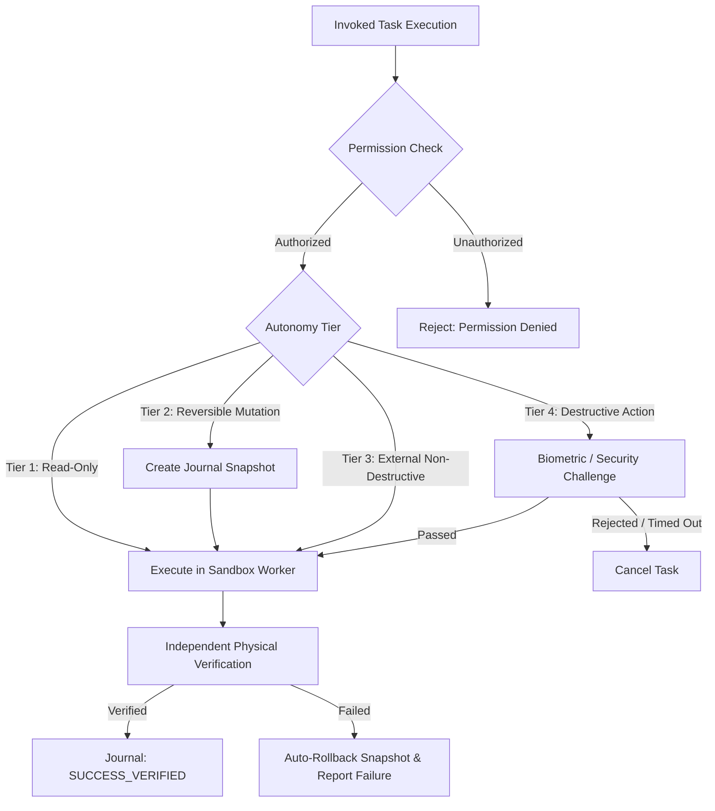

# CAPABILITY FABRIC SPECIFICATION

> **Subsystem:** EON Capability & Tool Runtime  
> **Module:** `engine/core-rs/crates/eon-capability`  
> **Integrates:** Vector Governed Tools + CHRONOS Android Accessibility Controllers + Cyber Defense/Offense Core + Multimodal Vision Grounding

---

## 1. Overview & Capability Philosophy

The **Capability Fabric** is the operational surface through which EON interacts with the physical device, operating system, applications, file systems, network, and cyber substrates.

In adherence to Vector, CHRONOS, and Ciel principles:
1. **Contract-First**: Every capability declares a strongly-typed schema, semantic version, and explicit input/output structures. No arbitrary `Map<String, Any>` or raw unvalidated strings are passed across capability boundaries.
2. **Bounded Output Principle**: A capability never returns an unbounded memory blob into cognitive context. If reading a 500 MB file, it returns a bounded range, a summary, or a SHA-256 digest + URI pointer.
3. **Execution Sandboxing**: Capabilities execute within bounded workers with CPU/memory limits, timeouts, and cancellation hooks.
4. **Independent Verification Hook**: Every capability contract implements an asynchronous `verify()` method that inspects ground truth after an operation completes.

---

## 2. Capability Architecture & Interface Contracts

The capability runtime is authored in Rust (2024 Edition) under `engine/core-rs/crates/eon-capability`:

```rust
use async_trait::async_trait;
use serde::{Deserialize, Serialize};
use eon_primitives::{EonError, EonResult, IdentityId, MonotonicInstant};

#[derive(Debug, Clone, Copy, PartialEq, Eq, Hash, Serialize, Deserialize)]
pub enum VerificationStatus {
    /// Physically verified against OS, hardware sensor, AST, or cryptographic digest
    SuccessVerified,
    /// Execution returned success, but hardware/environmental feedback is absent or non-deterministic
    ExecutedUnverified,
    /// Execution reported success, but independent verification proved failure
    VerificationFailed,
}

#[derive(Debug, Clone, Copy, PartialEq, Eq, Hash, Serialize, Deserialize)]
pub enum CognitiveTaint {
    /// Originates from authenticated human operator (voice utterance, direct terminal/keyboard input)
    TrustedOperator,
    /// Originates from external, potentially adversarial sources (web pages, third-party repos, decompiled APKs, external accessibility nodes)
    UntrustedExternal,
}

#[derive(Debug, Clone, PartialEq, Eq, Serialize, Deserialize)]
pub struct CapabilityOutcome {
    pub status: VerificationStatus,
    pub payload: serde_json::Value,
    pub taint: CognitiveTaint,
    pub execution_duration_ns: u64,
}

#[derive(Debug, Clone, PartialEq, Eq, Serialize, Deserialize)]
pub struct CapabilityDescriptor {
    pub identifier: String,          // e.g. "workspace.read@v1", "dev.lsp@v1", "process.pty@v1"
    pub description: String,         // Semantic purpose
    pub operations: Vec<String>,     // Supported operations
    pub permissions: Vec<String>,    // Required security permissions
}

#[derive(Debug, Clone)]
pub struct ExecutionContext {
    pub caller_id: IdentityId,
    pub cognitive_epoch: u64,
    pub timeout_ms: u64,
    pub is_shadow_sandbox: bool,
    pub sandbox_root: Option<String>,
}

#[async_trait]
pub trait Capability: Send + Sync {
    /// Returns the static metadata descriptor for this capability.
    fn descriptor(&self) -> CapabilityDescriptor;

    /// Executes an operation within a bounded asynchronous execution context.
    async fn execute(
        &self,
        operation: &str,
        parameters: serde_json::Value,
        context: &ExecutionContext,
    ) -> EonResult<serde_json::Value>;

    /// Independently inspects physical ground truth after execution.
    async fn verify(
        &self,
        operation: &str,
        parameters: &serde_json::Value,
        outcome: &serde_json::Value,
    ) -> EonResult<VerificationStatus>;
}
```

### Deterministic Mapping: `VerificationStatus` to `TaskState`
The Vector Execution Kernel (`eon-kernel`) consumes `VerificationStatus` and transitions task lifecycles deterministically:

| Capability `VerificationStatus` | Kernel `TaskState` | System Reaction |
|---|---|---|
| `SuccessVerified` | `TaskState::Completed` | State delta committed to journal; child tasks unblocked. |
| `ExecutedUnverified` | `TaskState::UncertainFailure` | Logged to journal; halts automatic chained execution of non-idempotent mutations. |
| `VerificationFailed` | `TaskState::Failed` | Triggers self-healing loop ($N \le 5$) or saga rollback of partial state. |

---

## 3. Core Capability Catalogs

EON comes out-of-the-box with nine comprehensive capability domains:

### 3.1 Workspace & Artifact Capabilities (`workspace.*`)
Designed for safe, bounded, high-speed inspection and mutation of local code and documents.
- `workspace.read`: Reads UTF-8 or binary files within bounded line ranges or byte offsets. Returns SHA-256 digest and base64/UTF-8 content.
- `workspace.write`: Performs atomic file writes using temp-file replacement. Verifies file digest on disk immediately.
- `workspace.patch`: **AST-Anchored Symbol-Scoped Search/Replace**. Targets specific function/class syntax nodes via tree-sitter span and fuzzy whitespace-insensitive matching, completely eliminating fragile line-number diff failures.
- `workspace.snapshot`: Creates an in-memory or journaled Git worktree snapshot of a directory before mutations begin.

### 3.2 Process & Development Capabilities (`dev.*` / `process.*`)
Automates developer tasks, builds, tests, persistent interactive debugging, and code navigation deterministically.

#### Process Execution & Stateful Interactive PTYs (`process.*`):
- `process.exec`: Spawns one-shot local processes with bounded stdout/stderr buffers, timeout kills, and exit code capture.
- `process.pty_open`: Spawns a stateful, persistent pseudo-terminal (PTY) session (e.g. `bash`, `zsh`, `powershell`, `adb shell`, `gdb`, Python REPL, ssh). Allocates a native master/slave PTY pair (`portable-pty` in Rust), configures environment variables, and returns a unique `session_id`.
- `process.pty_write`: Writes raw byte sequences or interactive keystrokes (ANSI escape codes, Ctrl+C, Ctrl+D, interactive prompts) to the running session.
- `process.pty_read_ring`: Reads from an in-memory 10,000-line circular ring buffer for the active PTY session, supporting cursor-based pagination and ANSI strip/parse.
- `process.pty_signal`: Delivers POSIX / Windows signals (`SIGINT`, `SIGTERM`, `SIGWINCH` for terminal resize).

#### Development & Live Debugging (`dev.*`):
- `dev.build`: Runs project build tools (`gradlew`, `cargo`, `npm`, `clang`) with automatic failure log extraction.
- `dev.test`: Runs unit or integration tests, parses test XML/reports, and returns pass/fail summaries.
- `dev.ast_inspect`: Parses source code into ASTs (Kotlin, Rust, C/C++, Python, TS) to locate symbols, classes, or function signatures.
- `dev.lsp`: **Language Server Protocol (LSP) Client Multiplexer**. Manages JSON-RPC channels to `rust-analyzer`, `clangd`, `kotlin-language-server`, `pyright`, and `vtsls`.
  - `lsp.goto_definition`: Resolves cross-file symbol definitions in < 30ms.
  - `lsp.find_references`: Locates all usages across workspace.
  - `lsp.hover_type`: Resolves exact inferred types without compiler build.
  - `lsp.workspace_symbols`: Fast symbol fuzzy matching.
  - `lsp.diagnostics`: Retrieves compiler-grade type errors and warnings on demand without running full build scripts.
- `dev.dap`: **Debug Adapter Protocol (DAP) Bridge**. Drives live interactive debuggers over DAP JSON-RPC (`codelldb` for Rust/C/C++, `debugpy` for Python, `jdwp` for Android Dalvik/JVM).
  - `dap.launch`: Launches target binary or test under DAP control with specified arguments and breakpoints.
  - `dap.attach`: Attaches to an active background process, daemon, or Android PID via JDWP.
  - `dap.set_breakpoint`: Sets conditional or hit-count breakpoints at `(file, line)` or raw memory address.
  - `dap.step`: Controls execution flow (`continue`, `step_in`, `step_over`, `step_out`).
  - `dap.inspect_stack`: Captures stack frames, instruction pointers, and thread statuses on crash/stop events.
  - `dap.evaluate_expression`: Evaluates runtime expressions or reads live registers and heap variables, feeding the exact runtime state into Ciel's self-healing compiler loop.

**Implemented debugger boundary:** `eon_cyber::dev_dap::inspect` is a host API
on x86-64 Linux, not a remote debugger service. It selects a compiled-in
fixture and breakpoint, never a PID, user program or expression. The native
fixture reports its own allocation/free counts. The Python fixture reports
allocated and retained markers, not interpreter heap size. OpenJDK reports
live instance counts through JDI over private JDWP pipes; JDWP is not DAP.
The general attach, stepping and evaluation operations above are not exported.

#### Provisioning the confined Rust LSP

The verified Rust profile is a dependency-free 2021 library rooted at `src/lib.rs`.
Only explicitly opened `.rs` snapshots are visible. It does not read the real
workspace, run Cargo/rustc, load proc macros, or discover project configuration.
It is not a full Cargo workspace or a cold sub-50-ms guarantee.

On x86-64 glibc Linux, configure `OperatorServer::new(ServerKind::RustAnalyzer, …)`
with the **native server** (not a rustup proxy), its individual shared libraries
and ELF loader, and a protocol deadline. Keep the installation disjoint from the
workspace and immutable to project authors. Call `.with_rust_analyzer_task_group(…)`
with the absolute path of a trusted cgroup v2 with `pids.max` set to 1–24.
The host must be able to enroll the child in `cgroup.procs`; do not move it or
raise the ceiling while the session is live. Unsupported confinement fails
closed. Do not grant a runtime directory or use a shell wrapper.

To reproduce both gates from a trusted checkout, use Bash with `jq`, a systemd
user manager with the pids controller delegated, and the trusted rustup component
(`rustup component add rust-analyzer` if missing). Build outside the capped group;
run each test binary in its own capped transient service. `ldd` here is **only**
for the operator-installed image, never a project executable.

```bash
set -euo pipefail
manifest="$(git rev-parse --show-toplevel)/engine/core-rs/Cargo.toml"
exe=$(rustup which rust-analyzer)
libs=$(ldd "$exe" | awk '$2=="=>"{print $3} $1~/^\//{print $1}' | paste -sd:)
gate() {
    local target=$1 test=$2 bin
    shift 2
    bin=$(cargo test --locked --manifest-path "$manifest" -p eon-capability "$@" \
        --no-run --message-format=json | jq -ser --arg name "$target" \
        'map(select(.target.name == $name and .executable != null)) | last.executable')
    systemd-run --user --pipe --quiet --wait --collect -p TasksMax=24 -p Delegate=pids \
        --setenv=EON_TEST_RUST_ANALYZER="$exe" --setenv=EON_TEST_RUST_ANALYZER_RUNTIME="$libs" \
        --setenv=EON_TEST_RUST_ANALYZER_CGROUP=self "$bin" --ignored --nocapture --exact "$test"
}
gate eon_capability sandbox::rust_analyzer::tests::lsp_and_patcher_tests_rust_worker_kernel_denials --lib
gate local_lsp_rust_analyzer lsp_and_patcher_tests_confined_rust_analyzer --test local_lsp_rust_analyzer
```

#### Provisioning the confined TypeScript LSP

The verified x86-64 glibc profile uses vtsls 0.3.0 with TypeScript 5.9.3. It
runs the language service in-process on open document snapshots. It does not
run project code, load project plugins or discover files on disk.

From `engine/core-rs`, with a vetted Node 24.22.1 binary and the upstream
archives listed in `crates/eon-capability/provision/vtsls/inputs`:

```bash
bash crates/eon-capability/provision/build-vtsls.sh "$NODE" "$ARCHIVES" "$NEW_INSTALL"
```

Keep the emitted digest in trusted operator configuration, separate from the
image. Do not recalculate a pin from the file at launch. On a host with a
delegated pids controller, `bash crates/eon-capability/provision/test-vtsls.sh`
uses the absolute `EON_TEST_VTSLS` path and `EON_TEST_VTSLS_SHA256` to run
both the kernel-denial and semantic gates. A successful warm diagnostic
query does not imply a sub-50-ms cold start or Kotlin support.

#### Provisioning the confined Kotlin LSP

`ServerKind::Kotlin` has two operator-selected backends. Neither runs Gradle
or builds the user's project. The **built-ins-only worker** analyzes explicitly opened
`.kt` buffers as one Kotlin common 1.9 module using the compiler's built-ins.
There is no project classpath: `Int`, `List` and declarations in other open
buffers can resolve, but stdlib functions such as `listOf`, Java/Android APIs
and project dependencies cannot. Diagnostics are labeled accordingly.

From `engine/core-rs`, on x86-64 glibc Linux, use vetted **Temurin
17.0.21+9** and **Kotlin 2.4.21** distributions and a C compiler. Provision
offline in a new operator-controlled directory outside the project:

```bash
bash crates/eon-capability/provision/build-kotlin.sh "$JDK" "$KOTLIN_HOME" "$NEW_INSTALL"
```

The script verifies the Kotlin input JARs, links a private Java runtime and
prints one SHA-256 pin covering the JNI launcher, worker, compiler JARs and
runtime files. Store the pin independently; do not recalculate an expected
digest at launch. Configure `OperatorServer::new(ServerKind::Kotlin, launcher,
&[], deadline)` and `with_kotlin_task_group(group, pin)`. Supply an immutable
local installation, including protected ancestor directories, and an operator
cgroup v2 with `pids.max <= 24`. A missing pin, changed file or unsupported
host fails closed. Verification caps bytes hashed (192 MiB total) and checks
the deadline between reads; this cannot interrupt a blocked kernel filesystem
operation.

The worker receives only stdio snapshots, not a mount of the project or home.
Landlock grants individual pinned image files and the glibc loader/libraries;
there are no directory grants. The threaded profile caps address space at
2 GiB, CPU at 60 s and open descriptors at 64. Only Kotlin adds the read-only
self `RLIMIT_NOFILE` query and the ability to stack a stricter seccomp filter:
the launcher denies further exec before starting a thread or loading HotSpot.
Sockets **and socketpair** remain denied. No shell, script host, plugin loader,
compiler backend or project build is started. This is not a private mount/PID
namespace: read denials protect file contents, not all filesystem metadata.

Definitions, explicit named references, plaintext hover and pull diagnostics
use compiler bindings. Opening, changing or closing any file invalidates the
module's analysis. Operator-function reference searches (including implicit
indexing) are rejected rather than returning a partial list. `workspace/symbol`
does case-insensitive subsequence matching on named PSI declarations in open
files only, up to 256 matches. Oversized reports fail the request, not the session.

With a delegated systemd user pids controller, reproduce both kernel-denial
and semantic gates:

```bash
EON_TEST_KOTLIN="$NEW_INSTALL/kotlin-language-server" \
EON_TEST_KOTLIN_SHA256="$APPROVED_PIN" bash crates/eon-capability/provision/test-kotlin.sh
```

The two-file gate enforces **warm definition p95 <30 ms** and **warm diagnostic
p95 <50 ms** (20 samples each). Launch-to-first-diagnostic includes image
verification. Edit-to-fresh-diagnostic is measured separately and does not
reuse an earlier diagnostic report. These are fixture measurements, not a
latency guarantee for arbitrary sources.

**fwcd Kotlin Language Server snapshot backend.** To use stdlib/JVM semantics,
select `fwcd-kotlin-language-server` instead. Obtain fwcd's
[`server.zip`](https://github.com/fwcd/kotlin-language-server/releases/download/1.3.13/server.zip)
and [1.3.13 source ZIP](https://codeload.github.com/fwcd/kotlin-language-server/zip/refs/tags/1.3.13).
With the same vetted Temurin JDK, provision offline; the script checks both
archive hashes before compiling the `provision/fwcd` overlay with the release's
Kotlin 2.1.0 compiler. No Gradle wrapper or dependency resolver runs.

```bash
bash crates/eon-capability/provision/build-fwcd.sh "$JDK" "$SERVER_ZIP" "$SOURCE_ZIP" "$NEW_INSTALL"
# Preserve the emitted pin in trusted operator configuration.
EON_TEST_KOTLIN="$NEW_INSTALL/fwcd-kotlin-language-server" \
EON_TEST_KOTLIN_SHA256="$APPROVED_PIN" bash crates/eon-capability/provision/test-kotlin.sh
```

Use the same `OperatorServer::new` and `with_kotlin_task_group` API with the
new launcher and its independent pin. This is a patched fwcd, not the stock
CLI: `KotlinLanguageServer`, its text-document service, `SourcePath`, JVM
analysis, definition, references, hover and diagnostic conversion come from
fwcd. The fixed entry point accepts only open `.kt` snapshots (16 × 64 KiB),
with the release stdlib and the vetted JDK's `java.base` classes as data.
The client rejects an encoded document URI over 4096 bytes before sending
`didOpen`; the rejection leaves previously opened snapshots usable.
It does not expose upstream workspace/command RPCs, formatting, decompilation,
workspace symbols, database indexing, configuration, scripts or build output.
The stock server's unconditional scratch-directory creation is removed; the
kernel protections, including the no-exec seal, are unchanged.

Every open, change or close invalidates the module. Its source analysis is
rebuilt on demand; the compiler reuses one package-part provider for the two
fixed binary roots without retaining previous edits' source scopes. The
offline build checks the retained provider count after 32 compilations, and
the confined gate checks fresh caller diagnostics across 256 callee edits.
A diagnostic pull checks the requested document version and echoes it for the
client to verify. Warm
queries reuse the completed analysis of that exact set of buffers. The fwcd
gate tests `listOf`, `sum` and `repeat`, overload selection across files,
cross-buffer invalidation and close/reopen; it measures cold start and edit
to fresh report separately. On the AMD EPYC 9V45 Linux runner, the 20-sample
warm p95s with the bounded provider were **0.634 ms definition, 1.128 ms
references, 0.353 ms hover and 0.128 ms diagnostics**. Cold launch to first
diagnostic took **2.610 s**; edit to fresh report took **123.704 ms p95**.
The sub-50-ms warm target is **not** an edit-latency target.

### 3.3 Cyber Defense & Hardening Capabilities (`cyber.defense.*`)
Automates host security, static taint tracking, and live patching.
- `cyber.defense.ast_taint`: Traces untrusted user inputs to dangerous execution sinks across source code.
- `cyber.defense.auto_patch`: Generates and applies constant-time cryptographic checks, bounds checks, and sanitized inputs.
- `cyber.defense.ebpf_monitor`: Queries kernel-level syscall telemetry (with ETW / VpnService fallbacks) to detect unauthorized child processes or executable heap pages.
- `cyber.defense.apk_harden`: Verifies APK signing structures (v2/v3/v4), removes debuggable flags, and secures exported IPC endpoints.

### 3.4 Cyber Offense & Vulnerability Research (`cyber.offense.*`)
Supports reverse engineering, disassembling, and red-team penetration testing in isolated sandboxes.
- `cyber.offense.disassemble`: Disassembles ELF, PE, Mach-O, and DEX binaries into annotated assembly with CFG recovery.
- `cyber.offense.decompile_dex`: Decompiles Android Dalvik bytecode into Smali and Java source trees.
- `cyber.offense.lift_ir`: Lifts native machine instructions (x86_64, ARM64, Dalvik) into Ghidra P-Code SSA Intermediate Representation.
- `cyber.offense.sym_exec`: Runs symbolic execution (Z3 engine) over P-Code to discover input constraints capable of triggering buffer overflows or logic bypasses.
- `cyber.offense.fuzz_concolic`: LibAFL-powered coverage-guided fuzzer with Z3 concolic constraint solving for magic bytes.
- `cyber.offense.packet_craft`: Crafts custom raw TCP/UDP/TLS network frames to evaluate protocol robustness and port state.

### 3.5 Distributed Mesh Capabilities (`mesh.*`)
Coordinates tasks across the user's phone, workstation, and server.
- `mesh.rpc_quic`: Dispatches low-latency RPC requests to paired peer nodes over encrypted QUIC streams using `iroh`.
- `mesh.sync_crdt`: Synchronizes working memory, knowledge triples, and task DAG state across devices without locks via Loro CRDT.
- `mesh.split_inference`: Dynamically offloads compute-heavy SLM or cyber tasks to a high-compute desktop node.

### 3.6 Android System & Accessibility Capabilities (`android.*`)
Inherited and refined from CHRONOS's native accessibility controller:
- `android.screen_inspect`: Dumps active `AccessibilityNodeInfo` hierarchies. Returns visible UI elements, text, and clickable bounds. Supports automatic fallback to Set-of-Mark (SoM) visual grounding when views are obfuscated.
- `android.node_click`: Dispatches an accessibility click or gesture to a specific node ID, Set-of-Mark `mark_id` (e.g. `[7]`), or coordinate fallback.
- `android.input_text`: Enters text into the currently focused accessibility input field.
- `android.system_controller`: Interacts with system bars, media sessions (Spotify, YouTube), volume controls, and notifications.
- `android.overlay`: Controls EON's persistent HUD overlay, audio visualizer, and contextual notification cards.

### 3.7 Multimodal Vision & UI Grounding (`vision.*`)
Provides screen comprehension and visual grounding when accessibility trees are obfuscated or unavailable.
- `vision.screen_grounding`: Runs **OmniParser-v2** (YOLOv8 icon/widget detector + PaddleOCR/Surya quantized ONNX, ~45 MB) on screen frames to locate clickable elements, icons, and text boxes. Implements **Set-of-Mark (SoM) Tagging**: renders numeric badges (`[1]`, `[2]`, `[3]`) directly over candidate widgets, enabling the VLM to emit discrete tag references (`Click [7]`) mapped back to exact pixel centroids with 100% precision.
- `vision.keyframe_sample`: Controls the adaptive 1–5 FPS video capture loop and retrieves recent temporal frames from the 30-second visual ring buffer.
- `vision.video_query`: Queries the 3-Tier Video Ingestion engine, retrieving sparse SigLIP frame embeddings from `sqlite-vec` and loading high-resolution cropped keyframes for fine-grained inspection.

### 3.8 Sub-Agent Orchestration Capabilities (`task.*`)
- `task.spawn`: Spawns an isolated, ephemeral sub-agent with its own dedicated 4,000-token working context ledger. Runs targeted exploratory sub-goals and returns a 3-line diagnostic digest to the parent workflow.

### 3.9 Network & Web Capabilities (`net.*`)
Enables internet research and data acquisition without cloud model dependencies:
- `net.http_get`: Performs bounded HTTP requests with redirect limits and SSL verification.
- `net.download`: Downloads files directly to local storage with resume support and SHA-256 integrity validation.
- `net.scrape_clean`: Fetches a web page and extracts readable markdown/text using readability algorithms, stripping ads and JS bloat.

### 3.10 Hardware & Device Capabilities (`device.*`)
Direct hardware sensor and actuator control:
- `device.battery`: Queries battery level, thermal status, and charging state.
- `device.flashlight`: Toggles device torch and verifies state via `CameraManager.TorchCallback`.
- `device.camera_capture`: Captures a single frame from CameraX without opening a full camera app.

### 3.11 Neuro-Symbolic & Formal Reasoning (`reasoning.*`)
Provides mathematical and constraint-satisfaction solving to eliminate logical hallucinations:
- `reasoning.smt_solve`: Formulates and executes first-order SMT-LIB2 constraint problems using the embedded Z3 theorem prover. Deterministically resolves task scheduling windows, dependency version matrices, firewall rule satisfiability, and permission algebra in $< 10\text{ms}$.
- `reasoning.rollout_eval`: Evaluates Best-of-$N$ candidate solution patches across parallel shadow sandboxes, scoring candidates on compilation status, AST linter diagnostics, and unit test pass rates.

---

## 4. Capability Sandboxing & Permission Guardrails



### Invariants:
1. **Never Bypass Security Controls**: If an operation touches external accounts or deletes directories, the system halts at Tier 4 for explicit authorization.
2. **Snapshot-Before-Write**: Any write operation on user workspaces or configuration files MUST record a snapshot in the journal before touching the file system.
3. **Auto-Rollback on Failure**: If a multi-step task mutates 3 files and the 4th task fails, the capability manager automatically rolls back the 3 mutated files to their pre-workflow state unless explicit partial retention was requested.
4. **Cognitive Taint Tracking (Invariant 8 Compliance)**: Capability outcomes carry a `CognitiveTaint` tag. Any outcome marked `UntrustedExternal` taints the calling workflow context. Downstream tasks requesting `MUTATE_WORKSPACE`, `EXECUTE_PROCESS`, or `DEVICE_CONTROL` are blocked from autonomous execution unless their parameters are sanitized through an isolated Dual-LLM filter or validated via an explicit user confirmation gate.
