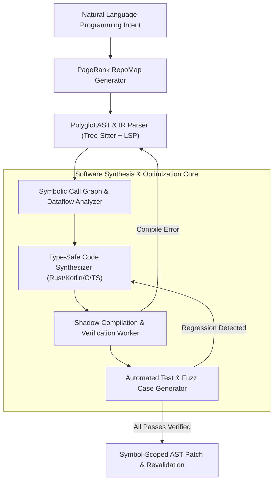
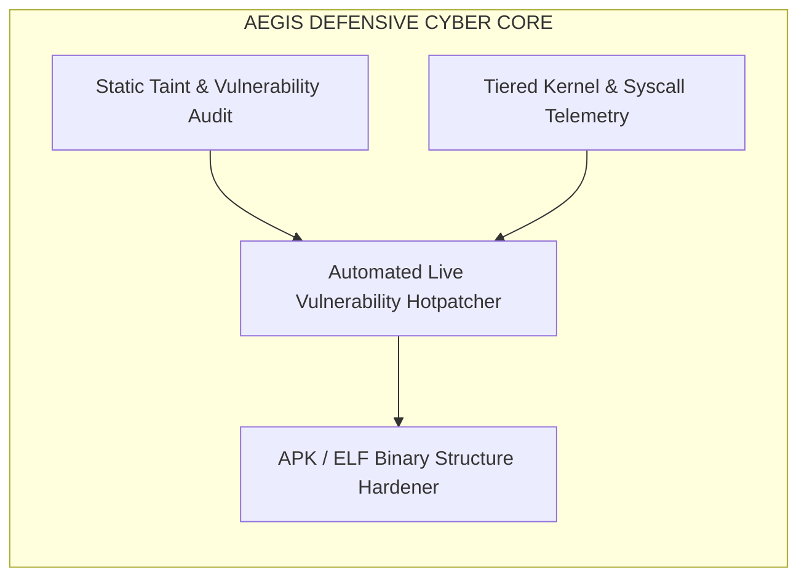
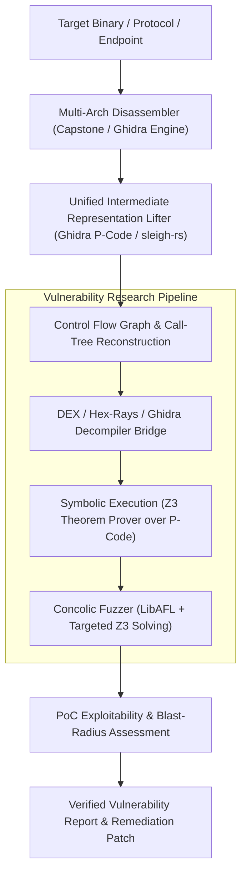

# CYBER AND PROGRAMMING MASTERY SPECIFICATION
### Information Particle Manipulation Subsystem

> **Subsystem:** EON Cyber & Software Engineering Core  
> **Module:** `engine/core-rs/crates/eon-cyber` & `engine/core-rs/crates/eon-capability`  
> **Archetype:** Information Particle Manipulation (*Jōhō Ryūshi Sōsa*)

> **Scope update:** [Roadmap Phase 7](./ROADMAP_AND_IMPLEMENTATION_PLAN.md#phase-7-program-analysis-and-defensive-security) supersedes this historical design. Only defensive analysis, containment and remediation are in scope. Offensive research proposals below are not deliverables.

---

## 1. Overview & Architectural Role

In the Ciel architecture, **Information Particle Manipulation** is the ultimate expression of control over the computational substrate. In EON, software, memory, binaries, and network packets are treated as malleable information structures.

EON is engineered to be an **elite-level programmer and cyber operator**:
1. **Extreme Programming & Autonomous Software Engineering**: Deep understanding of programming language semantics, AST manipulations, compiler optimizations, typing systems, memory safety, and distributed architectures.
2. **Defensive Cyber Operations**: Proactive, automated hardening of host systems, real-time threat detection, kernel-level anomaly monitoring, vulnerability remediation, and cryptographic integrity protection.
3. **Offensive Cyber & Security Research**: In-depth binary reverse engineering, unified intermediate representation lifting (Ghidra P-Code), symbolic execution, concolic fuzzing (LibAFL), automated exploit surface discovery, and red-team penetration simulation within isolated execution sandboxes.

---

## 2. Extreme Programming & Software Synthesis Engine



### 2.1 Supported Languages & Semantic Grammars
- **Systems Languages**: Rust, C, C++20, Go, Zig.
- **JVM / Android**: Kotlin, Java, Dalvik/ART DEX Bytecode, Smali.
- **Web & Scripting**: TypeScript, JavaScript, Python 3.12+, Shell/Bash, PowerShell.
- **Low-Level Machine Representations**: x86_64 and ARM64 assembly, LLVM Intermediate Representation (LLVM IR), WebAssembly (WASM).

### 2.2 Advanced Code Intelligence: Going Beyond Tree-Sitter
Tree-sitter is a fast Concrete Syntax Tree (CST) parser for individual files, but cannot resolve cross-file types or project-wide implementations. EON augments Tree-sitter with two enterprise-grade architectural layers:

1. **Language Server Protocol (LSP) Client Multiplexer (`dev.lsp`)**:
   - An embedded client in `eon-cyber` that manages background JSON-RPC sessions to `rust-analyzer`, `clangd`, `kotlin-language-server`, `pyright`, and `vtsls`.
   - Exposes sub-50ms diagnostic queries: `lsp.goto_definition`, `lsp.find_references`, `lsp.hover_type`, `lsp.workspace_symbols`, and `lsp.diagnostics`.
   - Validates type consistency across the workspace without triggering expensive, multi-minute compiler rebuilds.

2. **PageRank Repository Map (`RepoMap`)**:
   - Computes a global dependency graph of all symbols, structs, traits, and functions across the repository using Tree-sitter tags combined with LSP reference graphs.
   - Applies the **PageRank algorithm** to rank the architectural centrality of every symbol.
   - Condenses the top-ranked signatures into a high-density architectural summary (< 1,500 tokens) injected into Layer 1 Working Context, giving Ciel whole-project structural comprehension.

3. **Symbol-Scoped AST Search/Replace Patching**:
   - Discards fragile unified line-number diffs (`@@ -42,7 +42,9 @@`) which frequently fail on small LLM outputs.
   - Uses symbol-scoped search/replace blocks anchored to specific AST syntax nodes (e.g. `fn authenticate()` in `auth.rs`) with fuzzy whitespace-insensitive matching.

4. **Debug Adapter Protocol (DAP) Runtime Grounding (`dev.dap`)**:
   - Bridges to `codelldb` (Rust, C, C++), `debugpy` (Python), and `jdwp` (Android Dalvik/JVM).
   - Rather than guessing root causes from truncated panic logs, EON launches the failing binary under DAP supervision, sets conditional breakpoints, steps through execution, and inspects live heap variables, registers, and pointer alignments at the exact moment of failure.
   - Feeds real dynamic memory states into the AST repair synthesizer to eliminate subtle logical bugs and memory corruptions.

5. **Shared Content-Addressed Build Cache (`sccache`) Across Shadow Worktrees**:
   - To eliminate Cargo/Gradle build directory lock contention during parallel agent execution, all shadow worktrees are wrapped with `RUSTC_WRAPPER=sccache` targeting `~/.eon/build-cache/`.
   - Parallel tasks share compiled object files and dependencies without directory locking, reducing multi-branch compilation times by over 85%.

6. **AST-Aware 3-Way Structural Merging (Tree-sitter / `mergiraf`)**:
   - Replaces fragile line-based `git merge` with semantic Concrete Syntax Tree (CST) 3-way merging.
   - Merges concurrent import additions as set unions and independently added functions/methods into module scopes without textual conflicts, followed by a final gate test verification.

### 2.3 The Self-Healing Compiler Loop
When assigned to build or refactor code, EON executes a closed-loop self-correction cycle:
1. **Compilation**: Invokes host toolchains (`cargo`, `gradlew`, `clang`, `tsc`) with structured error capturing.
2. **Diagnostic & DAP Parsing**: Extracts line numbers, symbol mismatch tables, and borrow-checker diagnostics. For runtime test failures or crashes, invokes `dev.dap` to capture the live stack trace and variable state at the point of failure.
3. **AST-Level Remediation**: Rather than guessing string replacements, EON parses the file into an Abstract Syntax Tree, adjusts the specific syntax node, verifies type compatibility, and emits formatted code.
4. **Verification**: Re-runs compilation and test suites until zero warnings and zero test failures remain (looping up to $N=5$ autonomous repair iterations).

---

## 3. Defensive Cyber Subsystem (The Aegis Core)

The defensive subsystem continuously ensures that host systems, repositories, binaries, and networks remain impenetrable:



### 3.1 Static & Dynamic Taint Analysis
- **Vulnerability Scanner**: Scans code for Common Weakness Enumerations (CWEs):
  - Memory corruption (CWE-119, CWE-416 use-after-free, buffer overflows).
  - Injection flaws (CWE-89 SQLi, CWE-78 command injection).
  - Cryptographic weaknesses (CWE-327 broken crypto, hardcoded secrets, timing attack vulnerabilities).
- **Automated Remediation**: Synthesizes and applies mathematically sound patches (e.g. converting raw pointers to smart pointers/Rust lifetimes, replacing string concatenation with parameterized queries, enforcing constant-time comparisons).

### 3.2 Opt-in telemetry during a local source review

`eon-audit python --self-cpu-ebpf` requests a count of userspace CPU-clock
samples on the **calling thread** during the review. The fixed program cannot
accept a PID or program, follow children, inspect sample data, or capture
traffic. Without the opt-in flag the report omits the field. A restricted
caller still gets the source review, not a fabricated zero count.

**Android acceptance.** Start a fresh, no-audio x86_64 API 35 Google APIs AVD
named `eon-self-cpu` with SELinux enforcing. From the repository root, run
`bash engine/core-rs/crates/eon-cyber/tests/android_self_cpu/run.sh emulator-PORT`
with that AVD's serial. The Linux host needs the Android SDK (`ANDROID_HOME`),
build-tools 37.0.0, NDK 27.3.13750724, a JDK and Rust's `x86_64-linux-android`
target. The gate packages the locked, feature-enabled CLI in a test-only APK
with no requested permissions and removes it after comparison.

On the unmodified API 35 r9 SDK image (build `AE3A.240806.043/12960925`,
`userdebug`), the `untrusted_app` fixture had `CapEff=0` and `Seccomp=2`.
The default review omitted `self_thread_user_cpu_ebpf`; the opted-in review
returned `unverified` / `Unavailable` with no samples. The other JSON fields
matched. This is a native Android **denial** result, not a positive eBPF
measurement or a retail-device test. The image's `plat_sepolicy.cil` declares
`(typepermissive su)`: global `getenforce` alone would not validate a run in
that domain ([Android's per-domain validation guidance](https://source.android.com/docs/security/features/selinux/validate)).
The test does not elevate, change policy or use the platform's boot-time BPF loader.

**Windows acceptance.** `eon-audit rust --etw` submits one payload-free marker
to EON's own provider if enabled. It neither starts a trace nor monitors other
providers. A native Windows run must independently read the private ETL with
[`review_etw.ps1`](../engine/core-rs/crates/eon-cyber/tests/review_etw.ps1)
and find exactly one marker from the opted-in process and none from the
opted-out process. The test builds its reader with MSVC and the Windows SDK.
It checks `EVENT_RECORD.UserDataLength` in the closed trace without reading
the payload. An undecoded XML event is not proof of zero bytes.

### 3.3 Android APK & Binary Hardening
- Validates APK signature schemes (v1, v2, v3, v4).
- Audits Android Manifests for `exported="true"` activities, broadcast receivers, and content providers without permission guardrails.
- Verifies ELF native library hardening flags: `RELRO` (Relocation Read-Only), Stack Canaries, NX (No-Execute), and ASLR (PIE) compatibility.

---

## 4. Offensive Cyber & Vulnerability Research Subsystem

All offensive capabilities operate under strict governance: they are designed for security research, red-teaming, authorized penetration testing, and software validation.



### 4.1 Multi-Architecture Disassembly & Unified IR Lifting
To eliminate multi-architecture fragmentation (x86_64, ARM64, Dalvik DEX):
- **Disassembler**: Uses `capstone-rs` for rapid instruction decoding across architectures.
- **Unified IR Lifter (`sleigh-rs` Ghidra P-Code)**: Rather than attempting symbolic execution directly on raw assembly strings, all machine and Dalvik instructions are lifted into **Ghidra P-Code**, an explicit Static Single Assignment (SSA) intermediate representation with clear register/memory semantics.

### 4.2 Symbolic Execution & Exploit Path Finding
- Integrates SMT/SAT solvers (Z3) to solve constraints directly over P-Code SSA form.
- Determines whether user-controlled input can reach critical program counters (`PC` / `EIP`), corrupt return addresses, or bypass authentication logic without brute forcing.

### 4.3 Rust-Native Concolic Fuzzing (`LibAFL`)
- Replaces legacy external C++ AFL harnesses with **`LibAFL`** (the modular Rust-native fuzzing framework).
- Combines high-throughput concrete execution (> 10,000 execs/sec) with **Targeted Concolic Execution**: when concrete mutation stalls on complex magic-byte comparisons or cryptographic checksum gates, Z3 is invoked selectively to solve the branch constraint.

### 4.4 Ephemeral Sandbox Isolation Runtime
To ensure offensive research and untrusted binary execution never threaten host integrity:
- **Linux / Android**: Spawns isolated OCI containers via `youki` / `bubblewrap` or microVMs via **Firecracker** with strict cgroup resource constraints and unshared network namespaces.
- **Windows**: Executes within isolated Windows AppContainers or lightweight WSL2 microVM instances.

### 4.5 Persistent Interactive Shells & PTY Multiplexing in Cyber Operations
Real-world offensive security, dynamic binary analysis, and embedded firmware auditing cannot succeed through isolated one-shot process executions (`process.exec`). Stateful CLI sessions require bidirectional terminal persistence:

1. **Interactive Debugger Driving (`gdb` / `lldb`)**:
   - Rather than executing single non-interactive scripts, EON spawns a live PTY session via `process.pty_open`.
   - The agent writes interactive commands (`stepi`, `x/32xb $rsp`, `print $rax`), reads the streaming ANSI terminal output via `process.pty_read_ring`, and adapts memory analysis dynamically across dozens of task turns while the target process remains paused at a breakpoint.

2. **Persistent `adb shell` and Hardware Emulation Sessions**:
   - Maintains stateful interactive ADB roots, QEMU serial consoles, and busybox shells without incurring the ~300ms overhead of establishing new transport connections per command.
   - Enables continuous interaction with device-under-test (DUT) services, logcat streaming buffers, and Dalvik/ART internal hooks.

3. **In-Sandbox Exploit Listeners & Multi-Stage Stagers**:
   - Opens local listeners (`nc -lvnp`, mock reverse shells, HTTP staging servers) within the ephemeral Firecracker/bubblewrap sandbox.
   - Observes incoming payload connections in real-time, monitors stage-2 shellcode execution, and captures core dumps for post-exploitation invariant verification.

4. **Lifecycle & Session Governance**:
   - Sessions are identified by unique `session_id` tokens (UUIDv7/ULID) managed by the in-process PTY multiplexer in `eon-capability`.
   - An in-memory 10,000-line circular ring buffer captures raw output while stripping terminal escapes for LLM appraisal.
   - PTY sessions feature an idle watchdog (terminates after 300 seconds of inactivity without active I/O) and strictly bind to the lifecycle of the parent `WorkflowId`, preventing orphaned shell processes.

### 4.6 User-Space TCP/IP Stack (`smoltcp`) for Unprivileged Frame Crafting
Traditional network tools rely on raw sockets (`SOCK_RAW`, `AF_PACKET`) which fail across non-root environments:
- On Windows desktop (`x86_64-pc-windows-msvc`), the Windows kernel strictly blocks raw TCP socket transmissions, and tools like `pnet` fail without external proprietary Npcap drivers.
- On unrooted Android 14+ (`aarch64-linux-android`), SELinux policy unconditionally blocks `AF_PACKET` raw sockets.

`eon-cyber` overcomes these restrictions by integrating **`smoltcp`**, a pure-Rust, standalone, deterministic user-space TCP/IP/UDP/ICMP network stack:
1. **Unprivileged Android TUN Termination**:
   - When running on Android via `VpnService`, `smoltcp` attaches directly to the virtual TUN device file descriptor (`/dev/tun`).
   - Parses, routes, inspects, and filters packets entirely in user-space process memory with zero root permissions.
2. **Deterministic Protocol Fuzzing in Ephemeral Sandboxes**:
   - In offensive security and red-team simulations, `smoltcp` creates virtual loopback network interfaces entirely within process memory.
   - Enables fine-grained manipulation of TCP sequence numbers, window scaling, flags (SYN-ACK-FIN floods), MTU fragmentation, and handshake fuzzing without touching host kernel network interfaces.

---

## 5. Capability Contracts: Cyber & Coding Tools

Below are the strongly-typed Rust capability contracts exposed through `eon-cyber` and `eon-capability`:

```rust
use async_trait::async_trait;
use serde::{Deserialize, Serialize};
use eon_capability::{Capability, CapabilityDescriptor, ExecutionContext, VerificationStatus};
use eon_primitives::{EonResult, TaskId};

#[derive(Debug, Clone, Copy, PartialEq, Eq, Serialize, Deserialize)]
pub enum ThreatSeverity {
    Info,
    Low,
    Medium,
    High,
    Critical,
}

#[derive(Debug, Clone, PartialEq, Eq, Serialize, Deserialize)]
pub struct VulnerabilityReport {
    pub cwe_id: String,
    pub title: String,
    pub description: String,
    pub file_path: String,
    pub line_number: u32,
    pub severity: ThreatSeverity,
    pub suggested_patch: Option<String>,
}

#[derive(Debug, Clone, PartialEq, Eq, Serialize, Deserialize)]
pub struct SecurityAuditReport {
    pub workspace_path: String,
    pub vulnerabilities: Vec<VulnerabilityReport>,
    pub overall_threat_score: u32,
}

#[derive(Debug, Clone, PartialEq, Eq, Serialize, Deserialize)]
pub struct BinaryAnalysisSummary {
    pub binary_path: String,
    pub architecture: String,
    pub is_pie: bool,
    pub has_canary: bool,
    pub has_nx: bool,
    pub imported_symbols: Vec<String>,
    pub exported_symbols: Vec<String>,
}

#[async_trait]
pub trait AstSecurityAuditCapability: Capability {
    async fn audit_workspace(
        &self,
        workspace_path: &str,
        target_languages: &[String],
        threat_threshold: ThreatSeverity,
        context: &ExecutionContext,
    ) -> EonResult<SecurityAuditReport>;
}

#[async_trait]
pub trait BinaryInspectionCapability: Capability {
    async fn inspect_binary(
        &self,
        binary_path: &str,
        context: &ExecutionContext,
    ) -> EonResult<BinaryAnalysisSummary>;

    async fn lift_to_pcode(
        &self,
        binary_path: &str,
        symbol_or_address: &str,
        context: &ExecutionContext,
    ) -> EonResult<String>;
}

#[async_trait]
pub trait AutonomousPatchCapability: Capability {
    async fn synthesize_and_verify_patch(
        &self,
        workspace_path: &str,
        issue_description: &str,
        test_command: &str,
        context: &ExecutionContext,
    ) -> EonResult<bool>;
}
```

---

## 6. Autonomy and Safety Protocols for Cyber Operations

1. **Defensive Operations Are 100% Autonomous**:
   - Patching local vulnerabilities, running AST security audits, updating dependencies, and hardening binary configurations execute immediately without asking for user permission.
2. **Offensive & Penetration Testing Boundaries**:
   - In-memory disassembly, fuzzing local binaries, and AST symbolic execution execute autonomously within local sandboxes.
   - Any external network penetration testing or port scanning against remote IP addresses requires verified domain ownership or an explicit user directive.
   - Generating proof-of-concept exploits is strictly bound to ephemeral, air-gapped test sandboxes.
