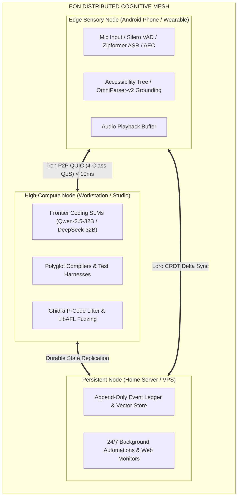
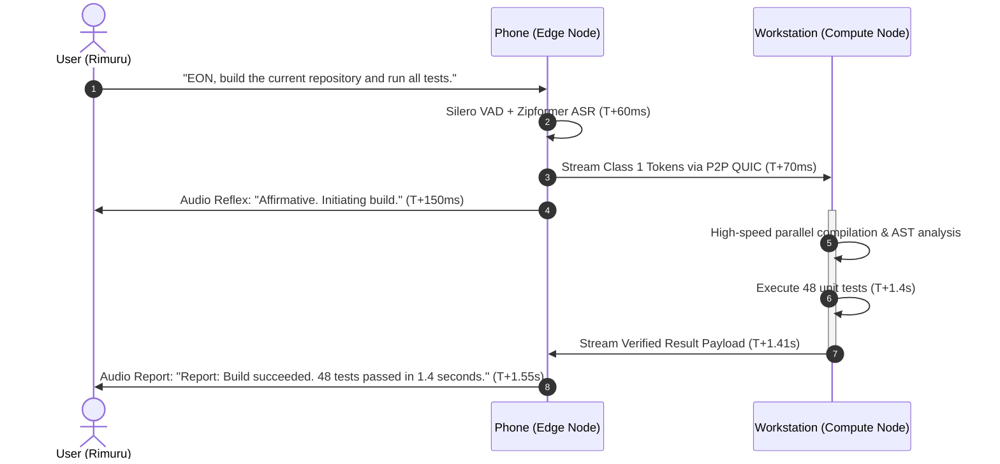
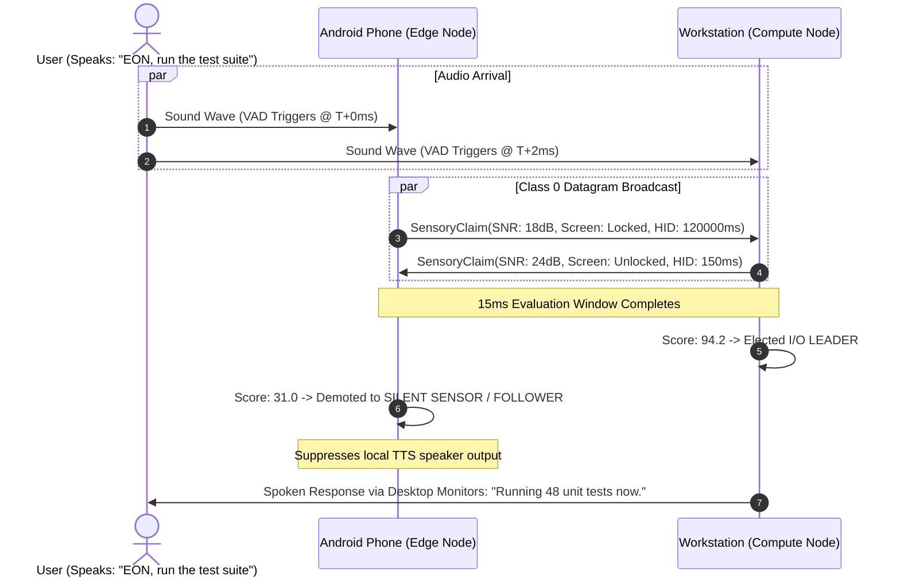

# DISTRIBUTED NETWORKING MESH SPECIFICATION
### Engine Optimized for Networking (EON Core)

> **Subsystem:** EON Networking & Distributed Mesh Engine  
> **Module:** `engine/core-rs/crates/eon-mesh` & `clients/daemon/mesh`  
> **Wire Protocol:** Protocol Buffers (`proto/eon.proto`) over `iroh` P2P QUIC / Loro CRDT

---

## 1. Vision & Architecture: Why "Engine Optimized for Networking"?

EON stands for **Engine Optimized for Networking**. A truly omnipresent, proactive AI companion like Ciel cannot be trapped inside a single isolated device. Ciel must exist wherever the user is—on their Android phone, desktop workstation, home server, or cloud nodes—functioning as a **single, unified, distributed cognitive mesh**.



---

## 2. Zero-Config WAN Roaming & Transport Layer (`iroh`)

Traditional mDNS discovery fails as soon as a user steps outside their home Wi-Fi and connects via 5G cellular. To provide seamless, uninterrupted roaming across the globe, EON adopts **`iroh`** (built on top of `quinn` in Rust):

### 2.1 Transport Primitives & Addressing
- **Cryptographic Node IDs**: Every EON instance generates a permanent Ed25519 keypair. The public key serves as the immutable Node ID across all networks.
- **Zero-Config NAT Traversal & Hole-Punching**: `iroh` automatically performs STUN resolution, UDP hole-punching, and NAT mapping.
- **Encrypted Relay Fallback (DERP)**: If direct UDP hole-punching is blocked by symmetric carrier-grade NAT (CGNAT), traffic seamlessly routes through encrypted relays with zero configuration.
- **Connection Migration**: Switching between home Wi-Fi, 5G mobile data, and public Wi-Fi retains active QUIC streams without dropping voice sessions or restarting file transfers.
- **Content-Addressed Blob Streaming**: Build artifacts, model weights, and video keyframes stream using BLAKE3-verified resumable chunks.

---

## 3. 4-Class QUIC QoS & Transport Priority Lanes

To prevent large file transfers (e.g. 500 MB build artifacts or model weights) from causing jitter on live voice frames, EON enforces **Four Strict QUIC Priority Lanes** serialized via `proto/eon.proto`:

| Priority Lane | Protocol Mechanism | Target Latency | Payload Types & Invariants |
|---|---|---|---|
| **Class 0: Real-Time Datagram** | QUIC Datagrams (RFC 9221) | **< 5ms** | 16kHz/24kHz raw PCM audio chunks, barge-in signals (`BargeInSignal`). Unreliable, unbuffered, zero head-of-line delay. Drops older frames if delayed. |
| **Class 1: Control Stream** | High-Priority Reliable Stream | **< 15ms** | Cognitive Epoch invalidations (`EPOCH_INVALIDATED`), streaming LLM tokens, lease heartbeats. Preempts all lower classes. |
| **Class 2: Interactive State** | Medium-Priority Stream | **< 50ms** | Loro CRDT delta-syncs (`CrdtDeltaSync`), compressed video keyframes (`VideoKeyframeChunk`), UI bounding boxes. |
| **Class 3: Bulk Background** | Throttled Background Stream | Bandwidth-limited | Model weight synchronization, compiler logs, git blobs, build artifacts. Automatically yielded when Class 0/1/2 are active. |

---

## 4. The Wire Serialization Contract (`proto/eon.proto`)

All inter-node and inter-process messages are strictly typed and binary-serialized using Protocol Buffers defined in [proto/eon.proto](../proto/eon.proto):
- `TaskExecutionRequest` & `TaskExecutionOutcome`: Governs remote capability execution.
- `EpochInvalidationEvent`: Dispatches immediate saga cancellations across the mesh.
- `AudioPcmChunk`: Streams Class 0 audio frames.
- `CrdtDeltaSync`: Replicates Loro CRDT document deltas.
- `SplitInferencePayload`: Streams speech tokens and inference states between phone and workstation.

*(Note: In-process Kotlin/Rust FFI on Android is governed separately by Mozilla UniFFI in `eon_core.udl`).*

---

## 5. Split-Inference & Offloading Engine

To maintain sub-200ms latency while running multi-billion parameter models, EON dynamically offloads work across the mesh:



### Graceful Offline Fallback:
If the desktop workstation is powered off or network connection is severed:
1. The mesh client detects connection loss within 500ms via QUIC heartbeats.
2. The phone seamlessly degrades to local on-device quantized models (`gemma-2-2b-it` or `Qwen2.5-Coder-3B` + `Kokoro-82M`) without throwing user-facing exceptions.
3. Pending background tasks are queued locally until mesh connectivity is re-established.

### 5.1 Implemented: token-only spoken dictation readback

The `eon-mesh` feature `token-readback` implements a narrower service than the sequence above. The edge recognizes one supplied recording (16 kHz mono PCM16, at most eight seconds). As the pinned Zipformer joiner selects nonblank **text token IDs**, it sends new IDs over a dedicated QUIC stream. The workstation detokenizes each prefix and returns a caption. After end-of-utterance it also returns Kokoro pronunciation IDs for “I heard …”. Neither side sends PCM, model weights, an action plan or a lease. Text token IDs reveal the spoken words; they are not anonymized or acoustic tokens.

- **Opt-in:** The host uses `split_inference::zipformer::readback::Readback::LocalOnly` unless the operator authorizes that recording with `AllowTokenPeer { pcm, edge, worker }`. A `TokenPeer` binds an explicit address and an out-of-band public-key pin. The worker must separately call `serve_one` with its pinned `Vocabulary`. There is no discovery, relay, implicit service start or downgrade to the older PCM ALPN.
- **Verification and fallback:** Every reply binds to a fresh utterance nonce and the ordered request prefix. The edge compares caption bytes with its own decoder and the final pronunciation with independently generated Kokoro IDs. On disconnect, timeout (500 ms per exchange), malformed reply, or content mismatch, it continues with the running edge recognizer and local pronunciation. Different phonemizer versions can legitimately select this fallback. Local ASR or TTS installation failures are errors, not successes.
- **Playback:** `Readback::queue` requires the caller's reply-scoped `ReplyRenderer`. Partial captions can update a display only. Successful finalization queues one attributed readback; silence queues nothing. The caller pumps Kokoro on its synthesis worker, and only a matching trusted kernel lease permits samples onto the bounded render ring. Interrupt via the same renderer’s revocation handle. The service never opens a microphone or speaker.
- **Interruption:** Revocation wakes a pending dial, stream operation or local model-step wait; a model step also has an eight-second deadline. Each individual edge QUIC write poll and final FIN is serialized with revocation, not the whole frame or an async wait. A poll already in progress may accept a prefix before revocation takes effect. Those bytes cannot be recalled and may arrive later, but no remaining fragment is submitted after revocation. The render callback does not take this lock.

To reproduce the private loopback gate with the repository's native voice prerequisites (ORT, espeak-ng, etc.), from the repository root:

```bash
python3 scripts/download_models.py --ids voice-test-zipformer-0 \
  zipformer-en-2023-06-26-{encoder-int8,decoder,joiner-int8,tokens} \
  kokoro-v1.0-release-int8 kokoro-v1.0-voice-af_heart
cd engine/core-rs
cargo test --locked -p eon-mesh --features token-readback --test split_token_readback -- --test-threads=1
```

The test uses the release recording/transcript and a second wire implementation that can partition or corrupt a reply. It checks the PCM consumed by the edge render callback using independent ASR. The default tests open no audio devices.

On Linux, `split_inference_tests_final_reaches_private_cpal_output` is an additional ignored, output-only gate. Use **only** a dedicated Pulse server with the single `eon_vad` null sink: set `PULSE_SERVER` to its private `unix:/…` socket, `PULSE_SINK=eon_vad`, `PULSE_SOURCE=eon_vad.monitor`, and `ALSA_CONFIG_PATH` to a file containing only `pcm.!default { type pulse server "<PULSE_SERVER>" }` plus newline (substitute the socket address). Set `EON_VOICE_TEST_PRIVATE_OUTPUT=1`, `EON_VOICE_TEST_VIRTUAL_MONITOR=1`, and `PULSE_LATENCY_MSEC=100`, then select the test with `-- --ignored`. It checks actual CPAL callback frame counts, driver errors, and ASR on the post-render reference. It does not open the monitor source, measure acoustic latency, or certify physical mobile hardware. Acoustic inference and waveform synthesis still run at the edge; rechecking the worker’s computation is intentional.

On the release recording, the edge sent 11 nonfinal chunks (38 ASR IDs before the flush). The 24 kHz ring consumed 162,000 samples; the 48 kHz private CPAL callback consumed 324,000 after resampling. The default Pulse buffer produced 14 driver errors. The 100 ms private-buffer run passed the same strict zero-error check; it is not evidence for a smaller output latency.

---

## 6. CRDT-Synchronized Cognitive State & Dual-Storage Projection

EON maintains a unified memory and task state across all devices using **Conflict-free Replicated Data Types (CRDTs)** powered by **Loro**:

### 6.1 Cognitive State CRDT Primitives
1. **Working Context Ledger (LWW-Element-Set CRDT)**:
   - The paired history records the speaker of an utterance, the fact of a clipboard event, or the focused application. Utterance and clipboard text never enter that history.
   - Updates use Lamport logical timestamps for deterministic merge resolution.
2. **Semantic Knowledge Graph (Loro Tree & Map CRDT)**:
   - Additions of entity nodes and relationship edges are commutative and associative.
   - Simultaneous fact additions on the phone and desktop merge deterministically without merge conflicts.
3. **Task & Execution Journal (PNCounter & ORSet CRDT)**:
   - Distributed task tracking. If a background download finishes on the server while the user is using the phone, the task completion event propagates immediately.

The Rust paired service negotiates `eon/mesh/paired/4`. Upgrade both peers together:
v3 uses incompatible Loro blob pages, and there is no fallback to v2 or to the
unpaired public document. The first pull pins the responder's target version for
that exchange; the push then targets the initiator's post-pull version. Later
edits remain for the next exchange. Each page carries at most 256 contiguous,
uncompressed protected map operations from one Loro change, with its writer,
first counter, timestamp, Lamport clock and dependencies. Snapshots and compressed
Loro blobs are not page formats. The entire framed RPC must fit 1 MiB.

V4 supports a combined frontier of at most 256 writers (and at most 256
dependencies per change). Exceeding that limit is a frontier error, not an
oversized-record error. New protected writes are limited to 512 KiB for the UTF-8
key and encoded value together; rejection leaves the history unchanged. A single
legacy record too large for a page is reported rather than skipped.

Push acknowledgements return the receiver's **applied** version; only the span
just sent is credited, even if the ACK also covers other operations. Already
imported operations are safe to replay. After disconnect or the 1024-RPC limit,
restart from the two actual version vectors; no saved network cursor is needed.

Ordinary sync does not log peer activity. To show completions in `eon watch`,
the initiating runtime can opt in to `observed::sync_with_observer` and append
its fieldless marker to a separate local telemetry journal. Open `/mesh` on
that journal to see the count and last sequence. These are completed calls, not
connected peers. A failed journal write is reported separately from the sync.

### 6.2 Projection into SQLite
CRDTs serve as the append-only replication log. On each local node, a background projection worker materializes the CRDT state into relational **SQLite (FTS5 + `sqlite-vec`)** tables, enabling sub-5ms hybrid BM25 and vector similarity queries.

---

## 7. Distributed Capability Execution & Remote Leases

Capabilities registered on any node in the mesh are callable across the network:
- A phone can dispatch a `dev.build` task that executes directly on the desktop's NVMe drive.
- A desktop script can dispatch an `android.node_click` or `android.overlay` action on the phone.

### Distributed Lease Protocol
- **Lease Coordination**: Managed via lightweight lease tokens with bounded physical wall-clock expiration (default: 5,000ms).
- **Network Partition Resilience**: If a network partition occurs, leases held on disconnected remote nodes expire after 5 seconds, allowing local execution to resume safely without deadlocking.

---

## 8. The 15ms Spatial Arbitration Protocol ("Single Mind, Multiple Bodies")

When a user works at their workstation with their Android phone resting on the desk, both devices' microphones capture the user's voice simultaneously. Without spatial coordination, both devices would appraise the intent, generate separate responses, and speak over each other in an echo disaster.

EON solves this with the **15ms Spatial Arbitration Protocol**, enforcing the illusion of a single, omnipresent cognitive entity:



### 8.1 The `SensoryClaim` Wire Datagram
As soon as `Silero VAD v5` detects voice activity on any local node, a lightweight `SensoryClaim` message (defined in `proto/eon.proto`) is broadcast across Class 0 QUIC datagrams (< 3ms network hop):

```rust
pub struct SensoryClaim {
    pub claim_id: String,           // claim_<ULID>
    pub device_id: String,          // Node public key
    pub vad_start_ns: u64,          // Monotonic capture start
    pub audio_snr_db: f32,          // Signal-to-Noise Ratio (dB)
    pub is_screen_unlocked: bool,   // Screen power & unlock state
    pub last_hid_activity_ms: u64,  // Milliseconds since last keyboard/mouse/touch
    pub speaker_confidence: f32,    // WeSpeaker biometric identity score
}
```

### 8.2 Deterministic Arbitration Scoring
All mesh nodes collect incoming claims over a strict **15ms window**. Each node computes a deterministic spatial score:

$$\mathcal{S}_i = 0.40 \cdot \overline{\text{SNR}}_i + 0.30 \cdot \mathbb{I}(\text{HID}_i < 2000\text{ms}) + 0.15 \cdot \mathbb{I}(\text{ScreenActive}_i) + 0.15 \cdot \text{SpeakerConf}_i$$

1. **Tie-Breaking**: If scores match within a 0.5% margin, the node with lexicographically smaller Node ID wins deterministically.
2. **I/O Leader**: The highest-scoring node assumes conversational focus. It alone drives Kokoro TTS audio playback and renders visual HUD notifications.
3. **Silent Followers**: Lower-scoring nodes immediately suppress local speaker output (`mute_speaker = true`). They keep their ASR stream active only if needed as a secondary acoustic diversity stream for noisy environments.
4. **Seamless Task Continuation**: If the user subsequently turns their head and touches the phone, the next turn's claim immediately shifts the I/O Leader role to the phone without interrupting background compilation on the workstation.
