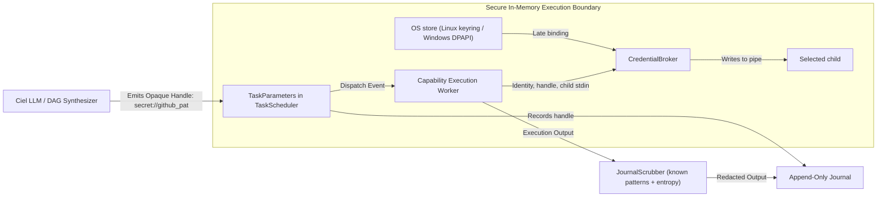

# FOUNDATION AND PRIMITIVES SPECIFICATION

> **Subsystem:** EON Core Foundation & Kernel Primitives  
> **Crates:** `engine/core-rs/crates/eon-primitives` (Level 0) & `engine/core-rs/crates/eon-foundation` (Level 1)  
> **Authority:** CANONICAL BLUEPRINT FOR ERROR TAXONOMY, IDENTIFIERS, JOURNALING & IDENTITY

---

## 1. Overview & Layering

To prevent circular dependencies and guarantee microsecond execution performance, EON enforces strict dependency stratification:

```text
Level 1: Foundation Services (eon-foundation)
         - Append-Only Binary Event Journal
         - Durable State Store (redb / SQLite WAL)
         - Identity & Permission Bitflags
         ▲
Level 0: Kernel Primitives (eon-primitives)
         - Strongly Typed Identifiers (Crockford Base32 ULIDs)
         - Monotonic Time (Nanosecond precision)
         - Result & Error Taxonomy (EonResult, EonError)
```

No crate at Level 0 or Level 1 may depend on higher-level execution, capability, cognition, or networking crates.

---

## 2. Strongly Typed Identifiers (ULIDs)

Identifiers in EON are globally unique, lexicographically sortable, URL-safe, and carry explicit type prefixes to eliminate parameter transposition bugs:

### 2.1 Canonical Prefix Table

| Prefix | Type Name | Crate | Purpose | Example |
|---|---|---|---|---|
| `obj_` | `ObjectiveId` | `eon-primitives` | High-level user or synthesized objective | `obj_01J9H2X7K9M4N3P2R1Q8S7T6V5` |
| `task_` | `TaskId` | `eon-primitives` | Atomic or expandable DAG task node | `task_01J9H2X7K9M4N3P2R1Q8S7T6V6` |
| `wf_` | `WorkflowId` | `eon-primitives` | Directed Acyclic Graph of tasks | `wf_01J9H2X7K9M4N3P2R1Q8S7T6V7` |
| `lease_` | `LeaseId` | `eon-primitives` | Atomic hardware/resource lock reservation | `lease_01J9H2X7K9M4N3P2R1Q8S7T6V8` |
| `id_` | `IdentityId` | `eon-primitives` | User, system, or sub-agent cryptographic identity | `id_01J9H2X7K9M4N3P2R1Q8S7T6V9` |
| `exec_` | `ExecutionId` | `eon-primitives` | Single invocation run trace | `exec_01J9H2X7K9M4N3P2R1Q8S7T6VA` |

### 2.2 Binary & String Encoding
- **Encoding**: 26-character Crockford Base32 (`0123456789ABCDEFGHJKMNPQRSTVWXYZ`, excluding `I`, `L`, `O`, `U` to prevent visual confusion).
- **Structure**:
  - 48 bits: Unix timestamp in milliseconds (gives monotonic chronological sortability until year 10,889 AD).
  - 80 bits: Monotonic counter + entropy (guarantees strict uniqueness even during high-frequency parallel task generation).
- **Validation**:
  ```rust
  let task_id = TaskId::from_str("task_01J9H2X7K9M4N3P2R1Q8S7T6V6")?;
  // Rejects invalid prefixes:
  assert!(TaskId::from_str("obj_01J9H2X7K9M4N3P2R1Q8S7T6V6").is_err());
  ```

---

## 3. The `EonError` Taxonomy & Result Types

All internal operations return `EonResult<T> = Result<T, EonError>`. EON defines a closed, strongly typed error taxonomy:

```rust
#[derive(Debug, Clone, PartialEq, Eq)]
pub enum EonError {
    /// Attempted to deserialize or cast an ID with an unexpected prefix
    InvalidId {
        expected_prefix: &'static str,
        actual: String,
    },
    /// Data contract, schema, or DAG validation failed
    ValidationError(String),
    /// Requested hardware resources (CPU cores, memory MB, disk locks) exceed budget
    ResourceExhausted {
        resource: String,
        requested: u64,
        available: u64,
    },
    /// A held resource lease timed out or expired
    ResourceLeaseTimeout {
        lease_id: String,
    },
    /// Action violates autonomy guardrails, permissions, or invariant policies
    SecurityViolation(String),
    /// Requested capability or tool is not registered on the current node or mesh
    CapabilityNotFound {
        capability_id: String,
    },
    /// Capability worker returned an execution failure
    OperationFailed {
        operation: String,
        reason: String,
    },
    /// Unrecoverable internal panic or substrate fault
    InternalError(String),
}
```

---

## 4. Append-Only Binary Event Journal (`eon-foundation`)

In strict adherence to **Invariant 4 (100% Durable Journaling & Crash Resilience)**, no state mutation occurs without prior commitment to the durable journal on disk.

### 4.1 Binary Journal Frame Layout

```text
 0                   1                   2                   3
 0 1 2 3 4 5 6 7 8 9 0 1 2 3 4 5 6 7 8 9 0 1 2 3 4 5 6 7 8 9 0 1
+-+-+-+-+-+-+-+-+-+-+-+-+-+-+-+-+-+-+-+-+-+-+-+-+-+-+-+-+-+-+-+-+
|                     Magic: 0x454F4E4A ("EONJ")                |
+-+-+-+-+-+-+-+-+-+-+-+-+-+-+-+-+-+-+-+-+-+-+-+-+-+-+-+-+-+-+-+-+
|          Version (u16)        |          Reserved (u16)       |
+-+-+-+-+-+-+-+-+-+-+-+-+-+-+-+-+-+-+-+-+-+-+-+-+-+-+-+-+-+-+-+-+
|                                                               |
+                    Sequence Number (u64)                      +
|                                                               |
+-+-+-+-+-+-+-+-+-+-+-+-+-+-+-+-+-+-+-+-+-+-+-+-+-+-+-+-+-+-+-+-+
|                                                               |
+                  Monotonic Timestamp (u64)                    +
|                                                               |
+-+-+-+-+-+-+-+-+-+-+-+-+-+-+-+-+-+-+-+-+-+-+-+-+-+-+-+-+-+-+-+-+
|                       Payload CRC32 (u32)                     |
+-+-+-+-+-+-+-+-+-+-+-+-+-+-+-+-+-+-+-+-+-+-+-+-+-+-+-+-+-+-+-+-+
|                      Payload Length (u32)                     |
+-+-+-+-+-+-+-+-+-+-+-+-+-+-+-+-+-+-+-+-+-+-+-+-+-+-+-+-+-+-+-+-+
|                                                               |
+                     Binary Payload Bytes                      +
|                 (Protobuf / Bincode Encoded)                  |
|                                                               |
+-+-+-+-+-+-+-+-+-+-+-+-+-+-+-+-+-+-+-+-+-+-+-+-+-+-+-+-+-+-+-+-+
```

### 4.2 Journal Invariants:
1. **Pre-Allocation & Zero Torn Writes**: Frames are flushed with `File::sync_data` prior to invoking external side-effects.
2. **CRC32 Checksumming**: Readers reject invalid frames. Opening the writer repairs an incomplete or zero-filled tail but refuses a complete frame with a bad checksum. Explicit operator repair is required in that case.
3. **Sequential Replay**: `replay` reads from sequence 1. `replay_from` includes the requested sequence and checks continuity in the visited suffix. It is not an integrity audit of segments before the checkpoint.
4. **Single writer**: Writer and repair operations take a nonblocking, per-directory OS lock. Readers need no lock. Do not remove the lock file or replace the active directory. After an uncertain append, close the writer and inspect the recovered tail before retrying.

### 4.3 Restoring a SQLite projection

`StateStore::commit_snapshot(name, journal_seq, state)` saves serialized state and advances its checkpoint in one transaction. An identical retry is safe. Stale state and conflicting bytes at the same sequence are rejected. SQLite positions are limited to `0..=i64::MAX`; values outside that range are not wrapped.

On restart, read `snapshot(name)` and replay from the sequence *after the snapshot*. A checkpoint advanced independently is not proof that its state was snapshotted. Apply missing records in memory before committing the caught-up state: a snapshot still behind the checkpoint will be rejected. An older database containing only checkpoints remains readable; if no snapshot exists, reconstruct from the journal.

---

## 5. Identity & Permission Bitflags (`eon-foundation`)

EON manages granular security authorizations across callers (human operator, system scheduler, sub-agents, remote mesh peers):

```rust
bitflags::bitflags! {
    #[derive(Debug, Clone, Copy, PartialEq, Eq)]
    pub struct Permissions: u32 {
        /// Allows reading workspace files, ASTs, and git history
        const READ_WORKSPACE    = 0b00000001;
        /// Allows mutating workspace files, writing patches, creating commits
        const MUTATE_WORKSPACE  = 0b00000010;
        /// Allows spawning local processes and compiling code
        const EXECUTE_PROCESS   = 0b00000100;
        /// Allows running static security audits, decompilation, and fuzzing
        const CYBER_OPERATIONS  = 0b00001000;
        /// Allows outbound network requests and mesh RPC
        const NETWORK_ACCESS    = 0b00010000;
        /// Allows controlling Android accessibility, gestures, and audio hardware
        const DEVICE_CONTROL    = 0b00100000;
        /// Allows spawning independent sub-agents
        const SPAWN_SUBAGENT    = 0b01000000;
    }
}
```

- **Ephemeral Sub-Agents**: When Ciel spawns an exploratory sub-agent, it receives bounded permissions (e.g. `READ_WORKSPACE | EXECUTE_PROCESS` for running tests, without `DEVICE_CONTROL` or `MUTATE_WORKSPACE`).
- **Remote Mesh Peers**: Unauthenticated or untrusted mesh nodes are restricted strictly to read-only or sandboxed execution scopes.

---

## 6. Zero-Knowledge Credential Broker & Journal Redaction (`eon-foundation`)

Keep raw credentials out of task parameters and journal records. Schedule an opaque handle instead; only the trusted worker supplies the sink when it needs the credential. Scrubbing output provides a second layer of protection, not a guarantee that every credential can be recognized.



### 6.1 Opaque Secret Handles (`secret://<vault_key>`)
- Do not pass raw API tokens, SSH keys, passwords or cloud credentials to a model, DAG definition or state journal.
- All credential references use opaque URI handles (e.g. `secret://github_pat`, `secret://aws_access_key`, `secret://id_ed25519`).
- A handle is not a bearer grant. The broker's argv check rejects `secret://` references; it never substitutes plaintext into arguments.

### 6.2 Platform stores
- **Linux**: The Rust broker holds key serials and lengths in memory. Payloads live in the Linux process keyring and are revoked on removal. This is a software store.
- **Windows**: The Rust broker retains only current-user DPAPI ciphertext and the expected plaintext length between calls. It does not require or attest a TPM.
- **Android**: The app host uses a non-exportable AndroidKeyStore AES-256-GCM key for a one-use inspection proof. The key can outlive the app process; proof entries and grants cannot. This is not a Rust child-stdin backend. Neither non-exportability nor an emulator test establishes TEE or StrongBox backing.

**Verifying DPAPI.** On native Windows, build the locked production dependencies
and require `windows_dpapi_owner_grants_and_child_stdin` and
`windows_dpapi_broker_lifetime_and_invalid_ciphertext` to each report `ok`.
Both passed in [Verification run 44989065768, attempt 2](https://github.com/Imperialorg/Eonba/actions/runs/44989065768/job/137110093511)
on `2d093bc` (`2 passed; 0 failed; 0 ignored`). The later failure in that job
was the independent ETW readback check, not a credential test.

### 6.3 Late-Binding Resolution in Memory
The host provisions or rotates an owner-scoped handle with `MANAGE_CREDENTIALS`. At execution time it calls `CredentialBroker::bind_to_stdin` with the selected child's pipe. Both `USE_CREDENTIALS` and `EXECUTE_PROCESS` are checked before the store is read. The broker writes into the pipe and wipes its transient buffer, including on write failure. It does not return plaintext to the caller or control what the child does with it.

### 6.4 Journal Secret Scrubber & Entropy Defense
Use `GroupCommitJournal::append_scrubbed` for free text. The raw append API accepts binary records and does not apply the text scrubber. Recognized credential prefixes and private-key blocks are redacted before the entropy pass.

The generic entropy rule checks mixed-class, base64-style tokens of at least 24 characters against a threshold of 4.65 bits per character; ordinary workspace paths are exempt. The hex rule checks unlabelled 40- and 64-digit values, including `key=value` assignments, without requiring mixed case. It measures the original characters and redacts above 3.75 bits per character. A 64-digit `sha256:` digest or a `commit ` hash with a standalone label stays readable. Matched values are replaced with a stable `[REDACTED_SECRET:b3_…]` marker before the frame is written.
