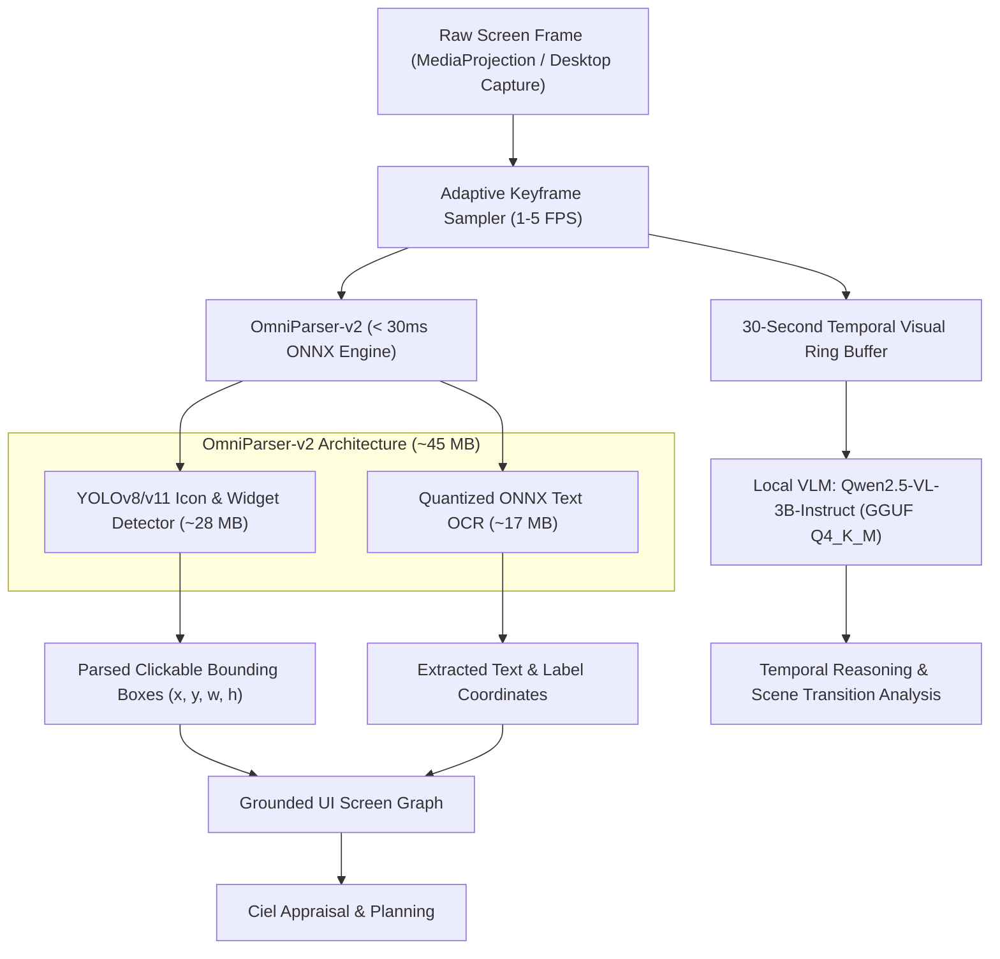
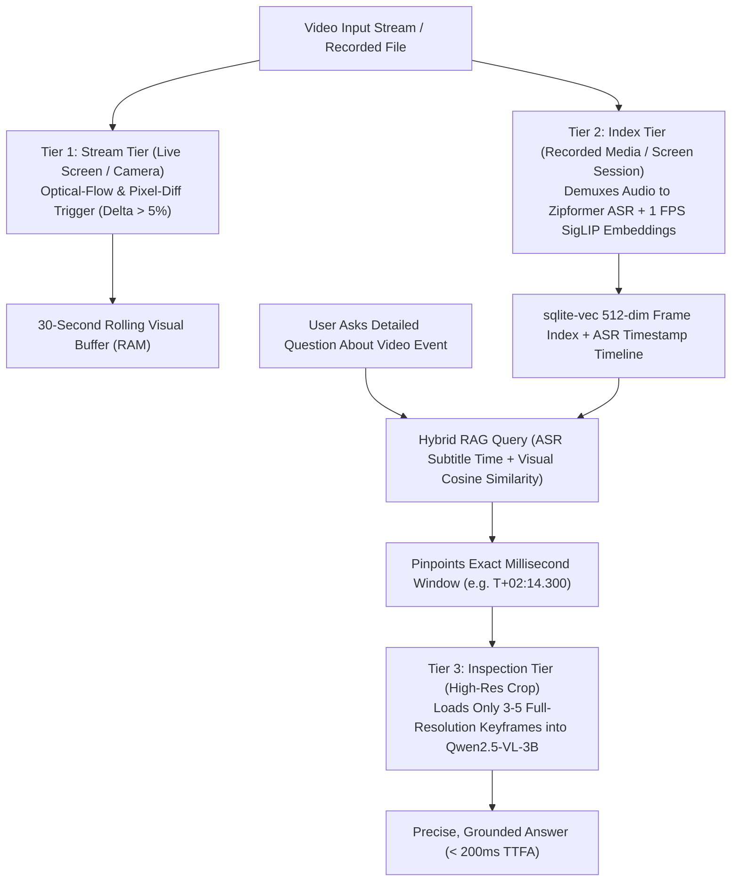
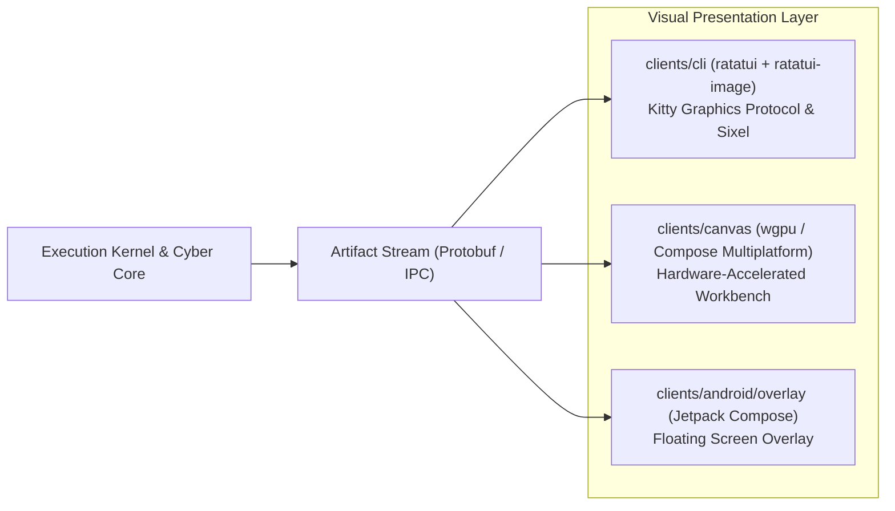

# MULTIMODAL VISION AND RENDERING SPECIFICATION

> **Subsystem:** EON Multimodal Vision & Visual Presentation Engine  
> **Module:** `engine/core-rs/crates/eon-vision` & `clients/canvas`  
> **Authority:** CANONICAL BLUEPRINT FOR VISION INPUT AND VISUAL RENDERING

---

## 1. Executive Summary & Design Rationale

To achieve peer status with human developers and autonomous frontier agents, EON cannot rely solely on plain text and audio. Real software environments, mobile applications, and system monitors are inherently visual:
1. **The Obfuscated Screen Problem**: Modern mobile and desktop apps (Flutter, Jetpack Compose, WebViews, Electron apps, games, remote desktop sessions) frequently present obfuscated or empty accessibility trees (`AccessibilityNodeInfo`). Without computer vision, an agent is blind on custom canvases.
2. **Temporal Video Input**: Users frequently ask temporal questions (*"What error just flashed on my screen?"*, *"Why did that test runner crash 5 seconds ago?"*). EON requires a hardware-accelerated video sampling loop with a rolling temporal memory.
3. **Rich Artifact Presentation**: Communicating complex architectural refactors, reverse-engineering control flow graphs (CFGs), and bounding-box debugging requires a high-performance visual canvas beyond terminal ASCII.

EON resolves this with **`eon-vision`** (the native Rust multimodal vision crate) and **`clients/canvas`** (the live GPU-accelerated artifact renderer).

---

## 2. On-Device Vision Models & UI Grounding

### 2.1 Fast UI Grounding Parser: OmniParser-v2 (< 30ms)
- **Model**: OmniParser-v2 composed of:
  - Specialized YOLOv8/v11 icon detector trained on mobile and desktop UI widgets (~28 MB ONNX).
  - Quantized PaddleOCR/Surya text recognition engine (~17 MB ONNX).
- **Execution Time**: < 30ms on modern CPU or mobile NPU.
- **Output**: Extracts every button, input box, icon, and text snippet with exact normalized screen coordinates `[x_min, y_min, x_max, y_max]` and clickability attributes.
- **Dynamic-First, Coordinate-Fallback Pattern**:
  1. *Dynamic Attempt*: Attempt to match elements via Android `AccessibilityNodeInfo` resource IDs.
  2. *Vision Grounding Fallback*: If the accessibility tree is blank (Flutter/WebView), query OmniParser-v2 bounding boxes.
  3. *Dispatch*: Dispatches tap gestures to the calculated visual centroid $(x_c, y_c)$.

### 2.2 Set-of-Mark (SoM) Visual Overlay Grounding
Small vision-language models (2B–3B parameters) struggle with predicting exact `[x, y]` floating-point pixel coordinates across diverse device aspect ratios and dynamic screen DPI scalings, leading to high click-miss rates. EON eliminates coordinate hallucination by converting continuous coordinate regression into **discrete classification via Set-of-Mark (SoM) Grounding**:

```mermaid
flowchart LR
    RawScreen["Raw Screen Capture"] --> Detector["OmniParser-v2 Detection (< 30ms)"]
    Detector --> Marker["SoM Tagging Engine (Draws [1], [2], [3] Badges)"]
    Marker --> TaggedImage["SoM Tagged Frame"]
    TaggedImage --> VLM["Local VLM (Qwen2.5-VL-3B)"]
    VLM --> SemanticChoice["Outputs Clean Action: 'Click [7]'"]
    SemanticChoice --> CoordinateMapper["SoM Registry: Maps [7] -> Centroid (x: 480, y: 1120)"]
    CoordinateMapper --> PhysicalClick["Dispatches Gesture with 100% Precision"]
```

1. **Tag Injection**: Before passing a screenshot or video frame to the VLM, `eon-vision` draws high-contrast, alphanumeric numeric badges (`[1]`, `[2]`, `[3]`, etc.) directly over every detected interactive icon, button, and input element.
2. **Discrete Choice**: The VLM simply outputs: `{"action": "click", "mark_id": 7}`.
3. **Exact Dispatch**: `eon-capability` queries the local `UiBoundingBox` table for `mark_id = 7` and dispatches the tap to its exact centroid $(x_c, y_c)$, achieving **100% spatial accuracy**.

### 2.3 Local Vision-Language Model (VLM): `Qwen2.5-VL-3B-Instruct`
- **Format**: GGUF `Q4_K_M` (~2.2 GB footprint), executed via `llama.cpp`.
- **Purpose**: Native multi-frame reasoning, chart and architectural diagram interpretation, error modal understanding, and spatial visual question answering.
- **Mobile Low-Memory Option**: `SmolVLM2-2.2B` (1.5 GB footprint) for memory-constrained mobile devices.

---

## 3. Real-Time Video Input Pipeline (`eon-vision`)

EON never feeds continuous 60 FPS video directly into an LLM/VLM. Instead, `eon-vision` runs an **Adaptive Keyframe Sampler**:

### 3.1 Adaptive Keyframe Sampler
- **Baseline Rate**: Samples screen frames at **1–2 FPS** during static or slowly changing content.
- **Dynamic Spike**: Spikes up to **5 FPS** when an optical-flow or structural similarity (SSIM) delta threshold indicates:
  - Rapid UI scrolling or screen transitions.
  - New window popups or dialog appearances.
  - Video playback or animations.
- **Hardware Acceleration**: Uses Android `MediaCodec` / Desktop `NVDEC` / `FFmpeg` hardware decoders.

### 3.2 30-Second Temporal Visual Ring Buffer
- A circular memory buffer in shared memory holding the last 30 seconds of compressed JPEG keyframes (~15–30 MB RAM footprint).

On Linux, `SharedVisualMemory` stores each accepted JPEG in a separate sealed `memfd`.
The capture owner selects frames with `recent(since_ms, now_ms)` and can pass an individual
descriptor to an authorized local reader. A reader can map that image but cannot alter it or
read adjacent frames. The sampling clock and byte budget bound what the producer retains,
not the lifetime of copies a recipient has already received. The buffer does not capture a
screen or send frames by itself.
- Enables zero-latency retrospective analysis:
  *"User: What was the error message that just disappeared?"*  
  Ciel immediately queries the buffer frames from $t_{-5s}$ to $t_{now}$, passes the cropped frames to OCR/VLM, and answers factually.

### 3.3 The 3-Tier Video Ingestion Architecture
Feeding dozens or hundreds of raw video frames directly into context windows is computationally impossible under the **< 200ms latency budget**. EON deploys a **Three-Tier Hierarchical Video Ingestion Architecture**:

1. **Tier 1: Stream Tier (Live Camera & Screen)**:
   - Evaluates optical-flow and lightweight pixel-diff metrics ($32 \times 32$ grayscale downsample).
   - Only triggers keyframe extraction when the visual scene changes by $\Delta > 5\%$, ignoring static desktop idling and preventing unnecessary inference load.
2. **Tier 2: Index Tier (Recorded Video Files & Background Sessions)**:
   - Demuxes the audio track directly to `sherpa-onnx` Zipformer ASR, producing a millisecond-accurate transcript timeline.
   - Extracts keyframes at a sparse 1 FPS rate and encodes each with an ultra-lightweight vision backbone (`SigLIP-base-int8` or `MobileCLIP`), storing 512-dimensional vector embeddings in `sqlite-vec` linked to file timestamps.
3. **Tier 3: Inspection Tier (High-Resolution Selective Crop)**:
   - When answering complex temporal questions (*"What was the stack trace on the terminal at 02:14?"*), Ciel does not scan the full video.
   - She executes a hybrid search over the transcript timeline and SigLIP frame embeddings to pinpoint the exact 3-second window.
   - Only **3 to 5 full-resolution cropped keyframes** are loaded into `Qwen2.5-VL-3B-Instruct`, extracting precise terminal text and answering the user in $< 200\text{ms}$.

---

## 4. Rich Visual Rendering & Live Artifact Canvas (`clients/canvas`)

EON provides interactive visual artifacts through a dedicated cross-platform canvas:

### 4.1 Cross-Platform Desktop Canvas (`clients/canvas`)
Powered by **`wgpu`** (or Jetpack Compose Multiplatform + Skia) for high-performance rendering:
1. **Interactive AST Diff Inspector**: Side-by-side color-coded syntax diffs with symbol tree folding and one-click rejection/acceptance.
2. **Reverse Engineering Control Flow Graphs (CFGs)**: Visual node-and-edge graphs rendered directly from Ghidra P-Code and Capstone disassembly, with basic block highlighting and branch condition annotation.
3. **Screen Bounding Box Overlay**: Live visual overlay showing detected OmniParser UI elements, clickable targets, and accessibility bounds.
4. **Video Timeline Scrubbing**: Temporal frame scrubber for reviewing recorded execution traces.

### 4.2 Terminal Graphics Protocol (`clients/cli`)
In modern terminal emulators (Ghostty, WezTerm, Kitty, Alacritty with Sixel):
- Uses `ratatui-image` supporting **Kitty Graphics Protocol** and **Sixel**.
- Renders inline architectural diagrams, thumbnail previews of captured screen frames, and high-resolution plots directly inside the console session.
