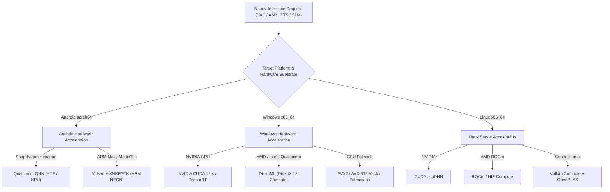

# TECH STACK & TOOLCHAINS SPECIFICATION

> **Subsystem:** EON Engineering & Build Infrastructure  
> **Architecture:** Native High-Performance Core (Rust) + Mobile Presence (Kotlin/Android)  
> **Authority:** CANONICAL REFERENCE FOR ALL IMPLEMENTING AGENTS

---

## 1. Executive Summary & Design Rationale

To achieve **Manas: Ciel's** performance targets—sub-200ms Time-to-First-Audio (TTFA), deterministic DAG scheduling, microsecond packet inspection, binary reverse engineering, and peer-to-peer QUIC mesh—EON eliminates runtime garbage-collection jitter on hot paths.

EON deploys a **Dual-Engine Architecture**:
1. **The Native Core Engine (`engine/core-rs`)**: Authored in **Rust (2024 Edition)**. Owns the audio loop, neural ONNX runtimes, the Vector DAG execution kernel, the Cyber and Information Particle manipulation engine, multimodal vision, and the P2P QUIC mesh.
2. **The Mobile Platform Presence (`clients/android`)**: Authored in **Kotlin 2.0 / Android SDK 35+**. Owns system-level accessibility node traversal, the persistent HUD floating overlay, camera frames, and Android system controllers.
3. **The Inter-Language Bridge**: Powered by **Mozilla UniFFI**, generating zero-overhead, memory-safe foreign function interfaces between the Rust core and Kotlin/Android without manual, error-prone JNI boilerplate.
4. **The Over-The-Wire Serialization**: Powered by **Protocol Buffers (`proto/eon.proto`)**, defining the typed binary contract for P2P QUIC mesh RPC (`eon-mesh`) and desktop daemon IPC (`clients/daemon`).

---

## 2. Language, Runtime & Compiler Matrix

| Layer | Language / Tool | Minimum Version | Target Triple / Runtime | Purpose |
|---|---|---|---|---|
| **Core Engine** | Rust | `1.82.0+` (Edition 2024) | `x86_64-pc-windows-msvc`<br/>`aarch64-linux-android`<br/>`x86_64-unknown-linux-gnu` | Kernel, Audio, DAG, Cyber, Mesh, Vision |
| **Android Presence** | Kotlin | `2.0.20+` | Android SDK 35 (minSdk 28) | Accessibility, Overlay HUD, System Controller |
| **Build System (Android)**| Gradle | `8.10+` with AGP `8.7+` | JVM 17/21 | Android packaging & compilation |
| **Build System (Native)** | Cargo | `1.82.0+` | Cargo Workspace with `cargo-ndk` | Native core compilation & cross-targets |
| **Inference Runtime** | ONNX Runtime | `1.20.0+` | C++ API / Native shared libraries | Silero VAD, Kokoro TTS, Zipformer ASR, OmniParser |
| **Local SLM Engine** | `llama.cpp` | Latest stable | GGUF Q4_K_M / Q8 quantization | Tactical on-device SLM (Qwen-2.5-3B, Qwen2.5-VL-3B, Gemma-2B) |
| **Grammar Engine** | `llguidance` / GBNF | Latest | Embedded in `eon-cognition` | Token-level logit masking for 100% valid JSON DAG synthesis (< 50µs) |
| **CLI / Terminal UI** | Rust | `1.82.0+` | Native CLI binary | Interactive terminal (`ratatui` + `ratatui-image`) |
| **Interactive Canvas**| Rust / Kotlin | `1.82.0+` | Cross-Platform (`wgpu` / Compose) | Live AST diffs, reverse engineering CFGs, screen overlays |

---

## 3. Rust Native Core Workspace Architecture (`engine/core-rs`)

The native engine is structured as a modular Cargo workspace with strictly enforced dependency boundaries:

```text
engine/core-rs/
├── Cargo.toml                         # Workspace root manifest
├── crates/
│   ├── eon-primitives/                # Level 0: ULIDs, MonotonicTime, EonResult, EonError
│   ├── eon-foundation/                # Level 1: Append-only journal (redb/SQLite), Identity, SecretScrubber
│   ├── eon-kernel/                    # Level 2 & 3: DAG scheduler, Epoch leases, Saga reconciler,
│   │                                  # sccache build cache sharing, Tree-sitter 3-way AST merge
│   ├── eon-capability/                # Level 4: Capability traits, LSP client multiplexer, Persistent PTY
│   ├── eon-cyber/                     # Information Particle Manipulation:
│   │                                  # - tree-sitter (AST parsing & self-healing compiler)
│   │                                  # - sleigh-rs (Ghidra P-Code unified SSA lifter)
│   │                                  # - LibAFL & z3 (coverage-guided concolic fuzzer)
│   │                                  # - smoltcp (pure-Rust user-space TCP/IP stack for unprivileged sandboxes & VPN TUN)
│   │                                  # - pnet / socket2 (raw network frame crafting where permitted)
│   │                                  # - aya-rs / ETW / VpnService (tiered telemetry + eBPF TLS SSL_write/read uprobes)
│   ├── eon-mesh/                      # Engine Optimized for Networking:
│   │                                  # - iroh (P2P QUIC, STUN hole-punching, Ed25519, relays)
│   │                                  # - loro (High-performance delta-state CRDT synchronizer)
│   │                                  # - 15ms Spatial Arbitration Protocol (SensoryClaim)
│   ├── eon-voice/                     # Real-Time Perception:
│   │                                  # - cpal / AAudio / WASAPI (native low-latency audio loop)
│   │                                  # - webrtc-audio-processing (AEC reverse reference loopback)
│   │                                  # - Silero VAD v5 (ONNX Runtime)
│   │                                  # - sherpa-onnx (int8 Zipformer streaming ASR)
│   │                                  # - misaki / espeak-ng (G2P IPA phonemizer & kokoro_vocab mapping)
│   │                                  # - Kokoro-82M (ONNX streaming neural TTS)
│   │                                  # - wespeaker (biometric speaker verification)
│   │                                  # - Acoustic Commitment Gate, Dual-Channel Verbalizer & Barge-in controller
│   ├── eon-vision/                    # Multimodal Screen & Video Perception:
│   │                                  # - OmniParser-v2 (YOLO icon detector + PaddleOCR ONNX)
│   │                                  # - Set-of-Mark (SoM) visual tagger ([1], [2], [3]) for 100% precision clicks
│   │                                  # - 3-Tier Video Ingestion (Stream pixel-diff, SigLIP sqlite-vec Index, High-Res Crop)
│   │                                  # - Adaptive 1-5 FPS keyframe sampler & 30s visual ring buffer
│   ├── eon-cognition/                 # Level 5: Thought Acceleration router, Ciel persona,
│   │                                  # llguidance / GBNF grammar-constrained decoding,
│   │                                  # z3 SMT solver bridge (reasoning.smt_solve & Best-of-N rollouts)
│   └── eon-uniffi/                    # UniFFI interface definitions for Kotlin & Swift
```

### High-Performance Cargo Profile Configuration (`Cargo.toml`)
```toml
[profile.release]
opt-level = 3
lto = "fat"
codegen-units = 1
panic = "abort"
strip = true
overflow-checks = false

# Dedicated profile for low-latency audio & network benchmarks
[profile.bench]
opt-level = 3
debug = true
lto = "thin"
```

---

## 4. Cross-Language Bridge vs. Wire Serialization

EON maintains a strict distinction between **in-process foreign function interfaces** and **over-the-wire serialization**:

| Layer | Contract Specification | Implementation | Purpose & Scope |
|---|---|---|---|
| **In-Process FFI Bridge** | `eon_core.udl` | Mozilla UniFFI | In-process zero-overhead bindings between native Rust core and Android Kotlin/Compose or Swift iOS frontends. |
| **Over-the-Wire Mesh RPC & IPC** | `proto/eon.proto` | Protocol Buffers (prost) | Cross-machine P2P QUIC messaging (`eon-mesh`), desktop daemon IPC (`clients/daemon`), and binary stream QoS framing. |

### 4.1 In-process interface

The [UniFFI definition](../engine/core-rs/crates/eon-uniffi/src/eon_core.udl) is the source of truth for both Kotlin and Swift. The `eon_uniffi` namespace exposes kernel IDs, process-relative monotonic time, model-profile selection, endpoint silence thresholds and dependency-graph validation. DAG validation returns IDs in dependency order; it cannot start a workflow.

`inject_audio_pcm_for_testing` requires one caller-supplied PCM16 frame of 512 samples at 16 kHz. It applies the gain controller and returns measurements, not a transcription. `execute_task_sync` accepts only the two local `diagnostics` operations listed in the interface. Neither call opens a microphone, grants a lease or dispatches a host command.

### 4.2 Cross-Compilation for Android with `cargo-ndk`
The Gradle wrapper builds and verifies the debug APK. On Linux, with the Android SDK in `ANDROID_HOME` and a JDK on `PATH`, run from the repository root:
```sh
"$ANDROID_HOME/cmdline-tools/latest/bin/sdkmanager" "platforms;android-35" "build-tools;37.0.0" "ndk;27.3.13750724"
export ANDROID_NDK_HOME="$ANDROID_HOME/ndk/27.3.13750724"
rustup target add aarch64-linux-android armv7-linux-androideabi x86_64-linux-android
cargo install cargo-ndk --version 4.1.2 --locked
cd engine/android
./gradlew :core-bindings:verifyTargetBindings :app:test
```
The APK is written to `app/build/outputs/apk/debug/app-debug.apk`. The verifier checks the packaged shared libraries, signature, alignment, and bindings for all three ABIs. These checks do not install the app or verify device permissions.

---

## 5. Android Client & UI Workspace (`engine/android`)

`core-bindings` generates Kotlin bindings from the Rust library. `app` packages the Android libraries and offers an explicit, one-shot focused-control inspection. It does not expose a general gesture dispatcher, a background microphone, or a screen-capture service. The [roadmap](./ROADMAP_AND_IMPLEMENTATION_PLAN.md) tracks the remaining mobile features separately from the APK build.

The Android **app host**, not the Rust foundation broker or UniFFI dispatcher, issues owner-bound manage/use grants. Foreground consent seals and verifies a one-use nonce with a non-exportable AndroidKeyStore AES-256-GCM key before arming the shortcut. A tap consumes the in-memory permit and reads focus synchronously. One fixed key alias survives restart; grants, opaque handles and encrypted records do not. No plaintext fallback or hardware attestation.

From `engine/android`, using the SDK/NDK setup above:

```sh
CARGO_TARGET_DIR="$PWD/../core-rs/target" ./gradlew --offline :app:test :app:assembleDebug
python3 app/keystore_device_test.py --build-only
"$ANDROID_HOME/platform-tools/adb" devices -l
python3 app/keystore_device_test.py --serial "$SERIAL"  # only the disposable API 28+ emulator you just created
```

The `android-debug` CI job runs the last command on a fresh API 35 x86_64 emulator. For a manual run, use a disposable target with neither EON package installed. Require both `PASS: issue` and `PASS: restart`. The first phase exercises authorization, invalidation and release, then encrypts a public fixture. After force-stop the second phase must decrypt that fixture with the surviving key, reject the old handle, and redeem a fresh one. An alias with the same name but a different key is not enough.

JVM tests and `--build-only` do not exercise AndroidKeyStore. A passing emulator run does not attest physical hardware backing or verify the system shortcut UI.

**Built-in tone HUD (API 31+, no microphone or media-library permission needed for the tone).** With EON already
selected as assistant, invoke it while unlocked using the system assistant gesture. Expand
the card and tap **Analyze built-in notification tone**. This measures the first notification
sound on Android's **internal** media volume, not the user's selected ringtone, a recording,
or audio from another app. Nothing plays. Each bar is a 100 ms PCM16 RMS level (the last
can be shorter), on a fixed 0–100% full-scale axis. Progress counts measured windows, up to
12; completion reports the highest RMS. An absent, unreadable or unsupported tone gives
an unavailable result, not a sample waveform. Stop/clear, collapse, hide, lock or loss of the
assistant binding retires the tone data. No levels or audio are saved.

The separate **Start 6-second microphone meter** uses `AudioRecord`, not the built-in
tone. Review the Android microphone permission in EON controls, then start a take in
an expanded, unlocked assistant card. Selection as assistant does not start capture.
The meter shows half-second RMS levels; Stop, hide or loss of the session ends the
take. It does not record to a file, listen in the background or measure acoustic TTFA.

Use separate instrumentation gates for the stock app and the selected assistant's tone, workflow and microphone controls:

* **Clean stock device:** On a **new disposable** `system-images;android-35;google_apis;x86_64`
  AVD, verify `adb -s "$SERIAL" emu avd name` matches the AVD you just created.
  Run `python3 app/keystore_device_test.py --serial "$SERIAL" --demo-denied --stock-hud --stock-assistant`.
  Expect `PASS: issue`, `PASS: restart`, `demo=PASS-denied`, `voiceHud=PASS-stock`, `assistantActivity=PASS-picker-canceled`, and
  `nativeVault=PASS`. The HUD gate checks EON is not selected, reads and cancels the real
  built-in tone, and renders measured levels in an **unattached** production view. It
  does not invoke a voice session. The separate role-picker check opens Android's picker
  and cancels without selecting EON.
* **Selected-role session:** On a separate disposable, unlocked API 34+ AVD, an operator
  must have installed the matching target APK and already chosen EON through Android's UI.
  No accessibility service is needed. Leave the test APK uninstalled and run
  `python3 app/keystore_device_test.py --preconfigured-hud-serial "$SERIAL"`. Follow its
  prompt: invoke EON, expand, analyze, wait for completion, tap Stop and clear, pause,
  close the card, wait a second, and invoke again. The observer must see a real completed
  graph, its cleared state, dismissal and a clean new card for
  `voiceHud=PASS-session`. It never injects gestures, changes roles or grants permissions.
* **Selected-role workflow:** Use a setup-complete, unlocked, disposable API 34+ AVD with
  less than 8 GB of memory and the system language set to English. Install the matching
  debug APK and choose EON as the digital assistant under Android Settings → Apps →
  Default apps. Leave the test APK uninstalled. No microphone or accessibility permission
  is needed. With EON's role status visible, run
  `python3 app/keystore_device_test.py --preconfigured-workflow-serial "$SERIAL"`.
  Invoke the assistant, expand the card and tap **Check model profile**. Expect one
  completed task and `p0_mobile_ultralight`. End the session, pause on the controls,
  then invoke and expand again without tapping Check. `workflowNotice=PASS-session`
  requires the original card's window to disappear while the other known windows remain,
  and the new card to have no result. As a negative control, collapse the card and tap
  through to the controls instead of ending the session. The observer must reject this
  at `dismissed-to-controls`. This checks a user-started workflow in the visible session,
  not a notification feed for other workflows.
* **Selected-role microphone:** Use a setup-complete, unlocked, disposable API 34+ AVD.
  Route its input exclusively to a private virtual audio source carrying a generated tone,
  never to the host microphone. Install the matching target APK and leave the test APK
  uninstalled. Run `python3 app/keystore_device_test.py --preconfigured-mic-serial "$SERIAL" --mic-phase denied`
  with EON selected but microphone access **not reviewed**. From EON controls, invoke
  the card through Android, expand it, pause with the meter off and tap Start. Leave
  the refusal visible for the observer.
  For the positive phases, review the permission through EON controls and Android's own
  prompt. If selecting the assistant produced a pre-existing OS grant, use a separate
  disposable AVD and review the permission **before** choosing EON. A grant alone is
  not a review. Repeat the command with `complete`, `stop` and `hide`, one phase per run.
  Start a fresh take for each. Let `complete` finish. For `stop` and `hide`, leave
  the first nonzero level visible for half a second, then tap Stop or dismiss directly
  without collapsing. For `hide`, leave the EON controls with role
  status visible for a second, invoke a fresh card, pause, then expand without starting.
  Expect `micHud=PASS-<phase>` for each run. The observer correlates clicks on this card
  with snapshots of EON's Android recording operation. It cannot see activity between
  snapshots, read PCM samples or measure power to a physical microphone.
  A build, permission dialog, silent input or built-in tone result does not verify capture.
* **Selected-role microphone, process death (9.5):** Use the APK build above with
  `ANDROID_HOME=/usr/local/lib/android/sdk`, JDK 17, Rust 1.100.0 and cargo-ndk 4.1.2.
  The run used emulator 37.3.10 (16970787), `system-images;android-35;google_apis;x86_64`
  rev 9, enforcing build `AE3A.240806.043/12960925`. Run adb, PulseAudio and the emulator
  as the KVM-capable user inside a fresh Linux network namespace with **only `lo` up**,
  no route, physical audio or cameras. In that namespace, set `D` to a new private build
  directory; use a fresh `pixel_4` AVD named `eon-mic-death` in `$D/avd`:
  ```sh
  export ANDROID_AVD_HOME="$D/avd" ANDROID_USER_HOME="$D/user" ANDROID_ADB_SERVER_PORT=5086
  export PULSE_RUNTIME_PATH="$D/pulse" PULSE_SERVER="unix:$D/pulse/native" PULSE_SOURCE=eon_fixture PULSE_SINK=eon_discard
  export QEMU_PA_SERVER="$PULSE_SERVER" QEMU_PA_SOURCE="$PULSE_SOURCE" QEMU_PA_SINK="$PULSE_SINK"
  mkdir -m 700 "$ANDROID_AVD_HOME" "$ANDROID_USER_HOME" "$D/pulse"
  pulseaudio -n --daemonize=no --exit-idle-time=-1 --load="module-native-protocol-unix socket=$D/pulse/native" \
    --load='module-null-sink sink_name=eon_discard' --load='module-sine-source source_name=eon_fixture frequency=440' &
  printf 'no\n' | "$ANDROID_HOME/cmdline-tools/latest/bin/avdmanager" create avd -n eon-mic-death \
    -k 'system-images;android-35;google_apis;x86_64' --device pixel_4
  "$ANDROID_HOME/platform-tools/adb" start-server
  xvfb-run -a -f "$D/auth" -s '-screen 0 1280x1280x24 -nolisten tcp' "$ANDROID_HOME/emulator/emulator" \
    -avd eon-mic-death -port 5586 -no-snapshot -no-boot-anim -gpu swiftshader_indirect -qt-hide-window \
    -camera-front none -camera-back none -audio pa -allow-host-audio -accel on
  ```
  Use the full Qt emulator on Xvfb; this release's `-no-window` binary did not initialize
  Pulse. Before granting access, match QEMU's client and source-output to the `eon_fixture`
  index (`pactl list clients short`, `pactl list sources short`, `pactl list source-outputs short`).
  Install the target and tap **Request microphone permission → While using the app** before
  selecting EON in Android's Default digital assistant app settings. Return to EON controls.
  Run `python3 app/keystore_device_test.py --preconfigured-mic-serial emulator-5586 --mic-phase process-death`
  as above. Invoke via the system Assist key, expand and pause. Save the single positive
  PID from `adb -s emulator-5586 shell pidof com.eon.assistant`, then tap **Start**.
  After the first nonzero level (~1.5 s), verify the PID is unchanged and the package's
  `cmd appops get com.eon.assistant RECORD_AUDIO` shows `(running)`. Send
  `adb -s emulator-5586 shell run-as com.eon.assistant kill -9 "$pid"`; do not dismiss or
  force-stop. After the old card disappears, invoke again, pause, expand, wait at least
  one second and tap **Start**. `micHud=PASS-process-death` verified AppOps release within
  1 s of detecting death, a different PID and idle card with no levels, and refusal of the
  new tap despite the retained OS grant. Omitting SIGKILL failed at `active-process-death`.
  Stop the private services and discard the AVD and namespace after the run.
* **Floating HUD (separate from the selected assistant):** On disposable, setup-complete
  API 35 AVDs, install the matching debug target and the signed test APK from
  `python3 app/keystore_device_test.py --build-only`. Use only a private virtual
  source for the microphone AVD. Do not pregrant microphone access or connect a host mic.
  Set `TEST=com.eon.assistant.keystoretest/com.eon.assistant.FloatingHudAcceptance`.
  Run `adb -s "$SERIAL" shell am instrument -w -r "$TEST"` and follow the printed
  `awaiting` checkpoints: review display and notification access in Android, tap
  **Start floating HUD**, return Home, run the notification profile check and tone,
  stop, start fresh, then turn the screen off. Expect `floatingHud=PASS-operator`.
  Separately run `adb -s "$MIC_SERIAL" shell am instrument -w -r -e mode mic "$TEST"`.
  From the floating controls, review while-in-use microphone access and tap
  **Start 6-second live mic** for each take. Let the first finish, stop the second
  using the notification and turn the screen off during the third. Expect
  `floatingHud=PASS-mic` and `INSTRUMENTATION_CODE: -1`, not just a successful `adb` exit.

**Optional process CPU measurement:** In EON, check **Measure EON process CPU during the next profile check**, then tap **Check model profile**. The box clears after one use or when leaving the activity. `SelfProcessCpu.measure` brackets that synchronous action with two `android.os.Process.getElapsedCpuTime()` reads only when requested. The result is a delta in **CPU milliseconds across all threads of the current app process**, not action latency, CPU percentage, or time attributable solely to that code. Equal positive counters can yield a genuine 0 ms at the counter's resolution. Missing/nonpositive, decreasing or out-of-order samples and intervals exceeding 10 seconds are unavailable. Neither sample leaves the call stack as a resumable baseline, so a process restart or reboot cannot produce a delta against old data. No listener, permission, persistent record or network access is needed.

With matching debug and instrumentation APKs already installed on an explicitly selected **disposable AVD**, run the separate gate (no arguments or grants):

```sh
"$ANDROID_HOME/platform-tools/adb" -s "$DISPOSABLE_AVD_SERIAL" shell am instrument -w -r \
  com.eon.assistant.keystoretest/com.eon.assistant.SelfCpuAcceptance
```

Require `selfCpu=PASS`, a positive `processCpuMs`, and `INSTRUMENTATION_CODE: -1`. This checks the production Android counter around bounded in-process CRC32 work; it does not exercise network/UID byte counters, VPN capture, ETW or eBPF.

---

## 6. Desktop & CLI Workspace (`clients/cli`, `clients/canvas` & `clients/daemon`)

For a live function diff on Linux, run `cargo run --locked -p eon-canvas --example diff -- --live before.rs after.rs` from `engine/core-rs`. Supply exactly two UTF-8 `.rs` or `.py` regular files on a local filesystem. The viewer pins each file once (requires Linux `openat2` and `/proc/self/fd`; no symlinks, including in ancestors). It reads only those handles: **in-place edits are visible; atomic saves, renames and unlinks do not switch to a new file**. Close and reopen to authorize a replacement. No directory watching, imports, program execution or write-back. Omit `--live` for a one-time diff, or omit both paths for the bundled example.

The live viewer samples at most twice a second, not once per paint. It compares exact bytes (64 KiB per file); only changed input is reparsed, including after a syntax error. Each parse is limited to 1,024 Tree-sitter progress checks, 24,000 syntax nodes, 128 functions and 256 KiB of function bodies including nested copies. A failed read, invalid UTF-8, recovered syntax tree or exceeded limit hides the diff and its review controls. A valid sample restores them. Decisions survive identical samples, not edits or failures. These are sampled views, not an atomic snapshot of both files or a hard I/O latency guarantee.

To review a recorded sequence, run `cargo run --locked -p eon-canvas --example scrub -- 1250 a.jpg 1480 b.jpg` in the Rust workspace with your own timestamps (milliseconds) and JPEG files. The slider follows elapsed time, not frame number. Input is limited to 150 frames in a 30-second window, 30 MiB compressed in total, and 4096 pixels per side. There is also a pixel-area limit before decoding to account for progressive JPEG buffers (1080p fits; 4K does not). The viewer keeps thumbnails up to 256 pixels per side and neither opens a capture device nor writes the source files.

To view a control-flow graph, redirect **one regular file** of GCC successor records into the canvas. From `engine/core-rs`:

```sh
cargo run --locked -p eon-canvas --example cfg < crates/eon-canvas/tests/fixtures/count_groups.cfg
```

Arrows point to successors. Pink arrows return to an earlier layer or to the same block; gold arrows go down the layers. Color does not indicate a branch condition. Scroll to explore a larger graph and hover a block for its exact successor IDs.

The file contains only `;; BLOCK succs { TARGET ... }` lines for **one function**. IDs are decimal `u32`s. An empty list declares a block with no successors. GCC omits the row for its artificial exit (block 1); the viewer includes it when referenced. Other targets need their own row. Duplicate blocks or edges are errors. Limits: 16 KiB, 32 blocks including the exit, 64 directed edges. The viewer reads once before opening the window. It does not open source files, follow paths in the input, invoke a compiler or execute the program.

To reproduce the fixture offline on Linux (GCC 13.3.0):

```sh
gcc -O0 -S -o /dev/null -fdump-tree-cfg=/dev/stdout crates/eon-canvas/tests/fixtures/count_groups.c |
  sed -n '/^;; [[:digit:]][[:digit:]]* succs /p' |
  diff -u crates/eon-canvas/tests/fixtures/count_groups.cfg -
```

For your own export, use a translation unit containing just the selected function and save the successor lines instead of running `diff`. Do not pass C, assembly, a binary, a pipe, or the full dump to the viewer.

For desktop workstations and servers:
- **Interactive Terminal**: Authored in Rust using `ratatui` + `crossterm` + `ratatui-image`. Displays live audio wave visualizers, active DAG task graphs, inline terminal graphics (Kitty/Sixel), and interactive slash commands (`/menu`, `/capabilities`, `/cyber`, `/mesh`, `/vision`).
- **Interactive Live Canvas (`clients/canvas`)**: High-performance graphical workbench powered by `wgpu` or Compose Multiplatform + Skia for live side-by-side AST diff inspection, interactive reverse-engineering CFGs, and screen annotation overlays.
- **Headless Daemon (`clients/daemon`)**: Background service using local Named Pipes on Windows (`\\.\pipe\eon`) and Unix Domain Sockets on Linux (`/tmp/eon.sock`), serializing messages via `proto/eon.proto`.

---

## 7. Hardware Execution Provider Matrix

To extract maximum performance from modern mobile SoCs and workstation GPUs while adhering to the **sub-200ms latency budget**, EON maps neural inference across platform-specific Hardware Execution Providers (EPs):



### Reproducing the native speech tests

The two reference recordings are test inputs, not dependencies of the app. From the repository root, install them with the same digest checks as the models:

```sh
python3 scripts/download_models.py --ids voice-test-sensevoice-en voice-test-zipformer-0 silero-vad-v5 \
  zipformer-en-2023-06-26-encoder-int8 zipformer-en-2023-06-26-decoder \
  zipformer-en-2023-06-26-joiner-int8 zipformer-en-2023-06-26-tokens
cargo test --locked --manifest-path engine/core-rs/Cargo.toml -p eon-voice \
  --no-default-features --features onnx-speech --test asr_e2e --test vad_e2e
cargo test --locked --manifest-path engine/core-rs/Cargo.toml -p eon-mesh \
  --features native-zipformer --test split_zipformer
```

The fetcher checks the release archives and the extracted WAV files. `onnx-speech` builds Zipformer and Silero without CPAL, WebRTC AEC, ALSA, Kokoro or WeSpeaker. The default `native` feature still includes the full audio stack. The `recorded-speech` CI job shows how to supply a digest-verified ONNX Runtime CPU library on x86-64 Linux. These tests measure inference on recorded input, not microphone-to-speaker latency.

#### Optional Sherpa C++ online recognizer (x86-64 Linux)

The `sherpa-onnx` feature selects Sherpa's **online C ABI** for `ZipformerAsr::load`. It uses the same four `2023-06-26` Zipformer files and `0.wav` installed above. The recognizer checks the hashes from `scripts/models.lock.json` before loading. Keep the local model directory read-only during use. Neither the build script nor the recognizer downloads anything. A C compiler and the following SDK are needed only for this feature.

```sh
# From the repository root; the SDK lives in the ignored build directory.
set -e
sdk=sherpa-onnx-v1.12.20-linux-x64-shared
dir="$PWD/engine/core-rs/target/sherpa-sdk"
mkdir -p "$dir"
curl -fL "https://github.com/k2-fsa/sherpa-onnx/releases/download/v1.12.20/$sdk.tar.bz2" -o "$dir/$sdk.tar.bz2"
(cd "$dir" && echo "13a2c502f5ef373f514a5fc5c5ad03cc0798dcb564a6f8cbd54f8f6ce9e47462  $sdk.tar.bz2" | sha256sum -c -)
tar -xjf "$dir/$sdk.tar.bz2" -C "$dir" "$sdk/include" "$sdk/lib"
export SHERPA_ONNX_DIR="$dir/$sdk"
export LD_LIBRARY_PATH="$SHERPA_ONNX_DIR/lib${LD_LIBRARY_PATH:+:$LD_LIBRARY_PATH}"
cargo test --locked --manifest-path engine/core-rs/Cargo.toml -p eon-voice \
  --no-default-features --features sherpa-onnx --test sherpa_e2e
```

For the in-process comparison, **keep the SDK's own `libonnxruntime.so` beside `libsherpa-onnx-c-api.so`**. Sherpa needs its versioned 1.17.1 symbols. Set `ORT_LIB_PATH` separately to the CI-pinned **1.31.0** CPU runtime directory (including its `libonnxruntime.so` link), `ORT_PREFER_DYNAMIC_LINK=1`, and add `"$ORT_LIB_PATH"` to `LD_LIBRARY_PATH`. Repeat the test command with `--features sherpa-onnx,onnx-speech --test sherpa_e2e --test asr_e2e`; `ZipformerAsr::load_ort` selects the independent direct decoder.

Push normalized 16 kHz mono samples into one `start_utterance()` stream per utterance. Each changed partial contains a replaceable, local intent preview; it cannot end the utterance or authorize an action. `finish()` alone flushes end padding. Dropping the stream discards an unfinished utterance. The tests use 20 ms pushes, not a 20 ms model latency claim.

### 7.1 Cross-Platform Acceleration Matrix

| Target Architecture | Neural Subsystem | Primary Hardware Provider | Fallback Provider | Key Compilation Flags / Libraries |
|---|---|---|---|---|
| **`aarch64-linux-android`** | VAD, ASR, TTS | Qualcomm QNN (Hexagon NPU) | XNNPACK (ARMv8.2-A FP16 NEON) | `--features qnn,xnnpack` with Android NDK r26c |
| **`aarch64-linux-android`** | Tactical SLM (GGUF) | Vulkan Compute (`llama.cpp`) | OpenMP multi-core CPU | `-DGGML_VULKAN=ON -DGGML_ARM_NEON=ON` |
| **`x86_64-pc-windows-msvc`** | VAD, ASR, TTS | DirectML (DirectX 12) | OpenVINO / CPU SIMD | `onnxruntime-directml.dll` linked via MSVC |
| **`x86_64-pc-windows-msvc`** | Tactical SLM (GGUF) | NVIDIA CUDA 12.4 / DirectML | AVX2 / AVX-512 FMA SIMD | `-DGGML_CUDA=ON` or `-DGGML_DIRECTML=ON` |
| **`x86_64-unknown-linux-gnu`**| VAD, ASR, TTS, SLM| CUDA 12.x / ROCm HIP | Vulkan Compute / oneDNN | `-DGGML_CUDA=ON` or `-DGGML_HIP_BLAS=ON` |

### 7.2 Mobile audio boundary
The packaged `libeon_uniffi.so` uses the portable voice features. Its test input is one PCM frame supplied by the caller. The acceleration matrix above describes target backends, not a verified Android microphone connection to AAudio, Sherpa or a hardware execution provider.

### Local still-image grounding (`eon-vision`, opt-in)

`paddle-ocr` reads text; `omniparser-icons` proposes icon regions. Both are off by default. They run locally with `ort` 2.0.0-rc.15 and do not capture screens, select frames automatically, authorize clicks or invoke a VLM.

On x86-64 Linux, run this once in Bash from anywhere in the checkout to provision the CI-pinned ONNX Runtime 1.31.0 CPU library. Use the same shell for the model-specific commands below. The wheel is extracted, not installed.

```bash
set -eu
repo="$(git rev-parse --show-toplevel)"
manifest="$repo/engine/core-rs/Cargo.toml"
ort="$repo/engine/core-rs/target/vision-ort-1.31.0"
mkdir -p "$ort"
python3 -m pip download --only-binary=:all: --no-deps --require-hashes \
  --implementation cp --abi cp312 --python-version 312 --platform manylinux_2_28_x86_64 \
  --dest "$ort" -r <(echo 'onnxruntime==1.31.0 --hash=sha256:5e129d6c56abd53e659cb70f00a108d6824086470ff99c2e47a82e5786563db3')
unzip -jo "$ort"/onnxruntime-1.31.0-*.whl 'onnxruntime/capi/libonnxruntime.so.1.31.0' -d "$ort"
ln -sf libonnxruntime.so.1.31.0 "$ort/libonnxruntime.so.1"
ln -sf libonnxruntime.so.1 "$ort/libonnxruntime.so"
export ORT_LIB_PATH="$ort" ORT_PREFER_DYNAMIC_LINK=1 LD_LIBRARY_PATH="$ort${LD_LIBRARY_PATH:+:$LD_LIBRARY_PATH}"
```

#### PaddleOCR text lines

The `paddle-ocr` feature runs the PP-OCRv4 detector and recognizer on CPU. `PaddleOcr::from_models` checks the **exact model bytes** and reads the character dictionary from the recognizer. The pins are from the two model entries in the `RECORD` of [RapidOCR's 1.4.4 wheel on PyPI](https://pypi.org/project/rapidocr-onnxruntime/1.4.4/#files). No Python package is installed or imported:

```bash
models="$repo/perception/models/vision/ppocr-v4"
mkdir -p "$models"
python3 -m pip download --only-binary=:all: --no-deps --require-hashes --dest "$models" \
  -r <(echo 'rapidocr-onnxruntime==1.4.4 --hash=sha256:971d7d5f223a7a808662229df1ef69893809d8457d834e6373d3854bc1782cbf')
unzip -jo "$models/rapidocr_onnxruntime-1.4.4-py3-none-any.whl" \
  'rapidocr_onnxruntime/models/ch_PP-OCRv4_det_infer.onnx' \
  'rapidocr_onnxruntime/models/ch_PP-OCRv4_rec_infer.onnx' -d "$models"
CARGO_BUILD_JOBS=6 cargo test --locked --manifest-path "$manifest" \
  -p eon-vision --features paddle-ocr
```

Call `recognize_jpeg(bytes, budget)` with an authorized still, or on Linux pass the result of `LiveSharedVisualMemory::select(sequence)` to `recognize_selected`. The latter reads only that sealed descriptor and checks the JPEG dimensions against the selected frame. Neither API captures a screen, accepts a JPEG filename, acts on text, or grants access. Results are untrusted horizontal text lines, in reading order, with half-open pixel bounds in the stored raster, not EXIF-rotated display coordinates. A blank image returns an empty list; selectors are never returned. This is not OmniParser widget/icon detection, VLM reasoning, or a click dispatcher.

Each call accepts at most 8 MiB of JPEG, 4,096 pixels per axis and 4,194,304 pixels total. The detector input is at most 960×960; more than 64 text candidates is an error. Recognition runs one crop at a time (at most 960×48). A caller deadline of up to 10 seconds covers the whole frame; ORT cancellation is cooperative and bounded decode/resize steps can finish after the deadline. A timeout does not return a partial page. The real-model tests compare text and all four edges against independently rendered JPEGs and exercise an older sealed selection after its capture history stops.

#### OmniParser-v2 icon proposals

The [ONNX Community export commit](https://huggingface.co/onnx-community/OmniParser-v2.0_icon_detect/commit/f0fbccdf5f56c2a689f669b95cb4f67bcf4e12b1) identifies Microsoft's `icon_detect/model.pt` as its source. The FP32 ONNX graph uses embedded tensors and standard operators. As a provenance cross-check, the three classifier head weights and biases (`model.23.cv3.{0,1,2}.2`) matched raw storage pairs 594/595, 620/621 and 646/647 of the locked Microsoft archive exactly after FP16→FP32 conversion. Inference requires neither pickle nor upstream Python code. The graph is **AGPL-3.0**, outside all hardware profiles; review the license before distributing it.

```bash
python3 "$repo/scripts/download_models.py" --ids omniparser-v2-icon-detect-onnx
cargo test --locked --manifest-path "$manifest" -p eon-vision --features omniparser-icons
cargo test --release --locked --manifest-path "$manifest" -p eon-vision --features omniparser-icons \
  --test still_icons selected_still_cpu_latency -- --ignored --exact --nocapture --test-threads=1
```

`omniparser::IconDetector::from_model` verifies the length and SHA-256 before passing any graph bytes to ORT. Reuse the detector. Pass an authorized JPEG byte slice to `detect_jpeg`, or on Linux pass the capture owner's explicit `LiveSharedVisualMemory::select(sequence)` result to `detect_selected`. `IconPage` returns single-class scores and half-open bounds in the stored raster, not names, text or clickability.

- **Geometry and limits:** The model takes RGB `[1,3,640,640]` in `[0,1]`, with aspect-preserving resize and centered gray (114) padding. Its `[1,5,8400]` head returns center x/y, width/height and one class score. Scores below 0.25 are discarded; single-class NMS uses IoU 0.45. Boxes are clipped to content and projected back using the actual rounded resize dimensions. The input and deadline limits are the same as for OCR; more than 256 surviving icons is an error, not a truncated page.
- **Functional checks:** Two independently rendered toolbar tiles matched their bounds (IoU ≥ 0.6) in both landscape and portrait. A blank image gave no proposals. Detecting an older sealed selection after the history stopped left the shared seek position unchanged. These cases are not a recall benchmark: borderless glyphs were not detected reliably.
- **CPU latency:** The release test checks every result and gates nearest-rank warm p95 at **<30 ms**. It times a selected 801×317 JPEG from positional read through decode, letterbox, inference and NMS, with eight intra-op threads. On a shared AMD EPYC 9V45, first call was 74.53 ms; after four additional warmups, 30 measured calls gave p50 130.33 ms and **p95 291.40 ms: target not met**. These are end-to-end times, not isolated kernel or mobile measurements.
