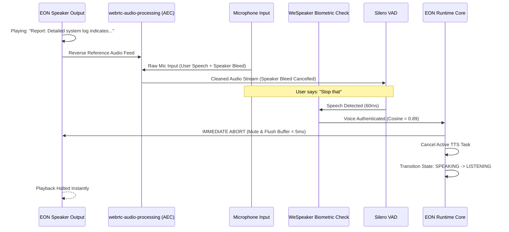

# VOICE PIPELINE SPECIFICATION (STT & TTS)

> **Subsystem:** EON Perception & Speech Engine  
> **Module:** `engine/core-rs/crates/eon-voice`  
> **Latency Target:** Time-To-First-Audio (TTFA) < 170ms | End-of-Utterance to Token < 70ms

---

## 1. Overview & Latency Architecture

To achieve the seamless conversational presence of **Ciel**, EON cannot use traditional request-response audio architectures that record a full WAV file, upload it to a cloud API, wait for full text, run a cloud LLM, and then wait for an entire audio file to download. That creates a 2.5 to 5-second delay.

EON utilizes an **end-to-end streaming, chunked, duplex audio pipeline** where speech recognition, cognitive routing, and neural voice synthesis run in a continuous streaming cascade.

```
[User Mic]
   │ (16kHz 16-bit PCM Audio Frames - 30ms chunks)
   ▼
┌─────────────────────────────────┐
│ Acoustic Echo Canceller (AEC)   │ ◄─── [Reverse Reference Stream from TTS Buffer]
└──────────────┬──────────────────┘
               │ Echo-Cancelled Audio
               ▼
┌─────────────────────────────────┐
│ Silero VAD v5 (30ms chunk)      │ ──► [Speech Detected: Confidence > 0.85]
└──────────────┬──────────────────┘
               │ Speech Active
               ▼
┌─────────────────────────────────┐
│ Enrolled speaker check (§2.3)   │ ──► [Match current speech before interrupting playback]
└──────────────┬──────────────────┘
               │ Authorized Audio Stream
               ▼
┌─────────────────────────────────┐
│ Streaming Zipformer int8 ASR    │ ──► Emits partial tokens every 60ms
└──────────────┬──────────────────┘
               │ End-Of-Utterance (250ms silence) -> Final Utterance
               ▼
┌─────────────────────────────────┐
│ Ciel Cognitive Router (SLM)     │ ──► Dual-Stream Split:
│                                 │     1. Silent <think>...</think> -> HUD / CLI only
└──────────────┬──────────────────┘     2. Post-</think> Tokens -> Clause Chunker
               │ Spoken Stream: ["Affirmative.", " Analysis", " complete."]
               ▼
┌─────────────────────────────────┐
│ Clause Chunker & Normalizer     │ ──► Sends first clause ("Affirmative.") in < 20ms
└──────────────┬──────────────────┘
               │ Normalized Text Clauses
               ▼
┌─────────────────────────────────┐
│ Kokoro-82M Neural Streaming TTS │ ──► RTF < 0.15 (Generates 1s audio in 150ms on CPU)
└──────────────┬──────────────────┘
               │ 24kHz PCM Audio Buffers
               ▼
[Native Audio Driver (AAudio/WASAPI)] ──► [Speaker] (User hears sound at T+170ms)
```

---

## 2. Low-Latency Speech-to-Text (STT) Subsystem

### 2.1 Acoustic Echo Cancellation (AEC) & Loopback Reference
To prevent EON from barging in on her own voice when speaking through open speakers:
- **Engine**: `webrtc-audio-processing` (or native DSP loopback).
- **Reverse Reference Stream**: The 24kHz TTS audio playback ring buffer is tapped and fed directly into the AEC module as the reference stream.
- **Echo Suppression**: Cancels acoustic bleed from the physical speaker into the microphone prior to feeding samples to Silero VAD.

### 2.2 Voice Activity Detection (VAD)
- **Model**: Silero VAD v5 (ONNX format, quantized int8, model footprint: 2.1 MB).
- **Frame Size**: 30ms (480 samples at 16,000 Hz, 16-bit linear PCM).
- **Processing Time**: < 0.8ms per frame on modern CPU.
- **Dynamic Thresholding**:
  - `start_speech_threshold`: 0.60 confidence score for 2 consecutive frames (60ms).
  - `end_speech_silence_duration`: 250ms of continuous silence below 0.35 confidence.
  - Dynamically lowers to 180ms when the user pauses after a complete syntactic sentence structure.

### 2.3 Enrolled speaker verification

During active playback, the native duplex path compares the **latest 17 consecutive 32 ms voiced frames** with a local enrollment from the same encoder. Only that 544 ms embedding can authorize mute, at the original cosine threshold (0.35 in the recorded acceptance test). Neither VAD nor audio from before this interval can supply an identity match. Shipping WeSpeaker staggers two short-window schedules eight frames apart. An unvoiced frame, an idle playback signal, a missing played reference or an inference error discards accumulated evidence. CAM++ retains its original disjoint-window schedule.

The render callback publishes each reference block before starting the next. On observing a restarted playback run, the worker discards both queues and both resampler histories, including any new-run audio already queued. A partial VAD frame and speaker evidence cannot cross runs. Only a block read within one active run may contribute to that run's mute decision. This establishes a software boundary, not a hardware capture timestamp or drift correction. The first run has no preceding played reference to discard.

`SpeakerEmbedder::load` uses the pinned WeSpeaker ResNet34-LM encoder (256 dimensions). For a new enrollment, `SpeakerEmbedder::load_for` can explicitly select `SpeakerEncoder::CamPlusPlusZhEnAdvancedV1` (192 dimensions). The loader checks the weights before opening the ONNX session. A voiceprint from a different encoder or feature pipeline needs fresh enrollment, not padding or truncation. See [the recorded comparisons](implementation/06_VERIFICATION_BENCHMARKS_AND_PHASED_PLAYBOOK.md#37-recorded-speaker-decisions-in-synthetic-noise-task-106) for results on competing speech and speaker changes.

The worker retains at most 8,704 candidate PCM samples. With a single encoder it computes one embedding per probe: every 256 or 288 ms during sustained voiced playback, versus every 544 ms with disjoint windows. These intervals describe fixture audio, not physical latency.

`SpeakerAgreement::enroll` is an opt-in two-encoder policy, not the default. It builds a separate template for each encoder from up to eight evenly spaced, nonoverlapping 544 ms excerpts of the same authorized enrollment. It skips digital silence and normalizes the sum of unit embeddings; it does not choose the best-scoring excerpt. A primary match triggers the second encoder on **the same candidate samples**, not earlier audio. Both must accept before mute. No measured improvement is claimed.

### 2.4 Streaming ASR Engine
- **Engine**: `sherpa-onnx` runtime with pre-packaged **int8 Streaming Zipformer**.
- **Model Parameters**: Multi-scale Zipformer transducer trained on LibriSpeech + GigaSpeech (streaming encoder chunk size: 32 frames = 160ms hop).
- **Latency**:
  - Emits partial transcripts incrementally every 100ms.
  - Final transcript available within **40ms** of VAD end-of-utterance trigger.

---

## 3. Neural Text-to-Speech (TTS) Subsystem

### 3.1 Streaming Neural Model (Kokoro-82M)
- **Architecture**: Kokoro-82M (StyleTTS2 and ISTFTNet-based architecture, 82 million parameters).
- **Quantization**: ONNX FP16 / INT8 optimized for on-device inference via DirectML / CoreML / ONNX Runtime CPU.
- **Sample Rate**: 24,000 Hz, 16-bit mono PCM.
- **Real-Time Factor (RTF)**: **0.12 - 0.18** on standard modern CPU (generates 1 second of audio in ~150ms).
- **Voice Timbre**: Crystalline, calm, authoritative, articulate, and intelligent—matching the Ciel aesthetic.

### 3.2 Token-to-Audio Streaming Pipeline (Clause Chunking)
Traditional TTS systems wait for an entire paragraph before synthesizing speech. EON employs **Incremental Clause Chunking**:
1. Cognitive core streams tokens: `TokenStream("Affirmative.")`, `TokenStream(" Beginning")`, `TokenStream(" build.")`.
2. The `ClauseChunker` splits on punctuation delimiters (`.`, `!`, `?`, `,`, `;`, `:`) or reaches an 8-word chunk boundary.
3. The first chunk `"Affirmative."` is dispatched to Kokoro within **20ms** of the cognitive core's first token.
4. Kokoro produces the first 800ms audio buffer in **50ms**.
5. Audio playback begins at **T+170ms**, while the next clause is synthesized concurrently in the background.

### 3.3 Grapheme-to-Phoneme (G2P) Frontend & Vocabulary Mapping
The Kokoro-82M neural ONNX graph does **not** ingest raw UTF-8 text strings directly; it requires a sequence of International Phonetic Alphabet (IPA) phoneme token IDs. To achieve real-time speech synthesis without external dependencies, `eon-voice` integrates an embedded **G2P Engine**:


1. **Native phonemizer (`espeak-ng`)**:
   - Runs the operator-installed `espeak-ng` on a trusted executable search path, with fixed `-v en-us -q --ipa=3` arguments. Clause text (at most 2,048 bytes) is stdin, never an argument.
   - Nonblocking stdin/stdout share a two-second elapsed deadline with process exit. More than 16 KiB of stdout fails the clause rather than truncating it; stderr is discarded. Readback and the normal reply renderer can cancel pending pronunciation. On cancellation, timeout or I/O failure, the worker kills the direct child and arranges to reap it without waiting on a pipe. Eight process-wide slots cover both running children and outstanding cleanup; calls fail without queuing if all are occupied. This deadline does not bound Kokoro inference.
2. **Phoneme Vocabulary Tokenizer (`kokoro_vocab.json`)**:
   - Maps known IPA symbols using `eon-voice/assets/kokoro_vocab.json`, skipping unmapped symbols as before. Requires 1–509 tokens before the two model boundary tokens.

### 3.4 The Dual-Channel Verbalizer Rule (Speaking Code Aloud)
In software engineering, devops, and cyber operations, raw technical text contains file paths (`engine/core-rs/crates/eon-cyber/src/ast/tree_sitter_engine.rs`), 64-character SHA-256 digests (`4722513f56da...`), raw pointers (`0x7fff5fbff8c0`), and Rust generics (`EonResult<Option<Arc<RwLock<Task>>>>`). Reading these character-by-character over audio creates acoustic chaos and listener fatigue.

Ciel strictly enforces the **Dual-Channel Verbalizer Architecture**:

1. **Dual-Channel Separation**:
   - **Spoken Summary Channel** (Kokoro TTS): Ciel emits a concise, conversational natural language synthesis designed purely for human listening.
     - *Spoken*: *"Report: Patched timing vulnerability in authentication service on line 84. All 14 unit tests passed."*
   - **Visual HUD / Terminal Channel** (Screen Overlay, Canvas, CLI): Full, unredacted AST diffs, line-number changes, SHA-256 digests, and compiler logs stream in real-time to the user's display.

2. **Acoustic Normalization Rules for Technical Terms**:
   When technical identifiers appear in the spoken stream, the verbalizer rewrites them for natural cadence:
   - `lib.rs` $\to$ *"lib dot R-S"*
   - `Cargo.toml` $\to$ *"Cargo dot tom-mel"*
   - `fn main()` $\to$ *"function main"*
   - `i32` / `u64` $\to$ *"32-bit integer"* / *"64-bit unsigned integer"*
   - `0x00007FFF` $\to$ *"memory address seven F-F-F"*
   - `v1.4.2` $\to$ *"version one point four point two"*
   - `4722513f...` $\to$ *"digest starting four-seven-two-two"* (truncates hashes to 4 hex characters)

---

## 4. Full Duplex & Acoustic Reflex (Barge-In)

A truly intelligent assistant must allow the user to interrupt at any time without having to wait for the assistant to finish talking.



### Barge-In Invariants:
1. **Zero Audio Lag on Cancellation**: When `BARGE_IN_TRIGGERED` is fired, the audio output driver buffer is flushed in **< 5ms** via native driver calls.
2. **Cancellation Journaling**: The cancelled speech task is recorded in the event journal as `INTERRUPTED_BY_USER` with the timestamp and token offset.
3. **Seamless State Handover**: The user's interrupting utterance is immediately routed to the Cognitive Core without requiring wake-words.

---

## 5. Audio Buffer Management & Hardware Drivers

To prevent memory leaks or audio jitter:
- **Audio Ring Buffer**: Fixed-size circular buffer holding 10 seconds of raw 16kHz audio (320 KB memory footprint).
- **Native Hardware Drivers**:
  - **Android**: Rust `eon-voice` opens native C/NDK `AAudio` / `Oboe` streams directly in `AAUDIO_PERFORMANCE_MODE_LOW_LATENCY` and `AAUDIO_SHARING_MODE_EXCLUSIVE`. Shared memory buffers ensure zero memory copies across language boundaries. (UniFFI `inject_audio_pcm_for_testing` is used only in test harnesses).
  - **Windows**: WASAPI in Exclusive Mode with 10ms event-driven buffer periods.
  - **Linux / macOS**: ALSA / PulseAudio / CoreAudio via `cpal`.
