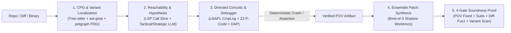

# Manual 03: 2026 Cybersecurity, Program Analysis, CRS, and Multi-Tier Sandboxing

> **Crates:** `eon-cyber` (`eon-cyber`, `eon-cyber-common`, `eon-cyber-ebpf`) and `eon-capability` (sandboxes)  
> **Companion Specs:** `CYBER_AND_PROGRAMMING_MASTERY.md`, `CAPABILITY_FABRIC_SPECIFICATION.md`, `ADR-0004-INFORMATION-PARTICLE-CYBER-MASTERY.md`

> **Scope update:** Follow the [defensive roadmap](../ROADMAP_AND_IMPLEMENTATION_PLAN.md#phase-7-program-analysis-and-defensive-security) and Manual 06's verification gates. The historical CRS proposals in this document are not instructions to generate exploits or execute targets.

---

## 1. Governance Boundary and Operational Scope

`eon-cyber` implements **Information Particle Manipulation** across three strictly governed engineering domains:
1. **Polyglot Program Analysis & Autonomous Software Synthesis**: Code Property Graphs (CPG), embedded LSP/DAP clients, PageRank RepoMaps, and self-healing compiler/debugger loops.
2. **Aegis Defensive Hardening & Runtime Telemetry**: Supply-chain verification (OSV, CycloneDX SBOM, SLSA), binary/APK hardening checks, CO-RE eBPF kernel telemetry/LSM guardrails, Windows ETW, and unprivileged `smoltcp` + JA4 network flow inspection.
3. **Autonomous Cyber Reasoning System (CRS) & Sandboxed Security Research**: Modeled on the 2025 to 2026 DARPA AIxCC winning architectures (*Team Atlanta ATLANTIS*, *Trail of Bits Buttercup*) and *Google Project Zero Big Sleep*, strictly scoped to local workspaces, user-owned targets, and air-gapped ephemeral sandboxes to discover bugs, prove reachability via deterministic Proof-of-Vulnerability (POV) inputs, and synthesize non-regressing security patches.

**Hard Safety Invariants**:
- Dynamic fuzzing, binary emulation, and packet crafting NEVER target external internet hosts; Tier S1/S3 sandboxes run inside unshared network namespaces or virtual `smoltcp` in-memory interfaces with zero host routing table access.
- Every finding is emitted in standard **SARIF 2.1.0** format with exact file/symbol spans, CWE classification, and reproducible verification test cases.

---

## 2. Workspace Layout for `eon-cyber` (3-Crate Split for `#![no_std]` eBPF)

Shipping Rust eBPF programs in production requires separating the `#![no_std]` kernel bytecode crate and its `#[repr(C)]` wire structs from the standard-library user-space crate:

```text
engine/core-rs/crates/
├── eon-cyber-common/               # #![no_std] shared POD structs (#[repr(C)], zero alloc)
│   ├── Cargo.toml
│   └── src/lib.rs                  # ExecEvent, TlsCleartextEvent, MemfdAlert, NetFlowEvent
│
├── eon-cyber-ebpf/                 # #![no_std] #![no_main] bpfel-unknown-none kernel probes
│   ├── Cargo.toml                  # Excluded from default workspace build; built via cargo xtask
│   └── src/
│       ├── main.rs
│       ├── vmlinux.rs              # Generated via aya-tool from BTF
│       ├── exec_trace.rs           # tracepoint/sched/sched_process_exec + memfd_create
│       ├── lsm_guards.rs           # lsm/bprm_check_security & lsm/file_open
│       └── tls_uprobe.rs           # uprobe/uretprobe SSL_write & SSL_read + BoringSSL
│
└── eon-cyber/                      # User-space Rust 2024 engine
    ├── Cargo.toml
    └── src/
        ├── lib.rs
        ├── cpg/
        │   ├── builder.rs          # Tree-sitter CST -> unified AST + CFG + PDG in petgraph
        │   ├── taint.rs            # Interprocedural source-to-sink taint & sanitizer dominance
        │   ├── repomap.rs          # Personalized PageRank symbol centrality (<1,500 tok)
        │   └── sarif.rs            # SARIF 2.1.0 importer/exporter (Joern/CodeQL/Semgrep bridge)
        ├── supply_chain/
        │   ├── osv.rs              # Offline/online OSV vulnerability & RustSec/npm/Maven matcher
        │   ├── sbom.rs             # CycloneDX 1.6 JSON generator + SLSA v1.1 provenance check
        │   └── binary_armor.rs     # goblin/object ELF checksec + Android APK v2/v3/v4 & Manifest audit
        ├── binary/
        │   ├── loader.rs           # object 0.36 + goblin ELF/PE/Mach-O/DEX loader
        │   ├── pcode_lifter.rs     # libpcode (0.1.8) pure-Rust Sleigh lifter + libsla (opt)
        │   ├── dex_ir.rs           # Dalvik DEX bytecode -> register SSA lifter
        │   └── emulator.rs         # icicle-vm P-Code interpreter & Cranelift JIT harness (opt)
        ├── crs/
        │   ├── localization.rs     # Diff/commit variant miner + CPG sink ranker
        │   ├── concolic.rs         # LibAFL 0.16.1 + CmpLog + stall-triggered Z3 QF_BV solver
        │   ├── debugger_agent.rs   # Big-Sleep style DAP (codelldb/gdb/jdwp) state inspector
        │   └── patch_verifier.rs   # 4-Gate patch soundness & differential micro-fuzzing
        ├── telemetry/
        │   ├── mod.rs              # Tiered Telemetry trait (Tier A / Tier B / Tier C)
        │   ├── aya_loader.rs       # Linux/Android Root BTF loader + AsyncFd<RingBuf>
        │   ├── boringssl_scan.rs   # ELF .dynsym + prologue byte-pattern offset finder
        │   ├── windows_etw.rs      # Windows Kernel-Process/Network/Threat-Intel ETW consumer
        │   └── userspace_net.rs    # smoltcp 0.14 TUN/virtual stack + pure-Rust JA4 TLS fingerprint
        └── sandbox/
            ├── mod.rs              # SandboxRunner trait + Tier selector (S1..S4)
            ├── linux_landlock.rs   # Landlock ABI v5/v6 + seccompiler BPF + bubblewrap
            ├── windows_appcont.rs  # Windows AppContainer + JobObject resource limits
            ├── firecracker_vm.rs   # KVM microVM + Jailer + vsock + air-gapped TAP
            └── wasm_capsule.rs     # Wasmtime 30.0 WASI 0.2 fuel & memory-capped runner
```

---

## 3. DARPA AIxCC-Class Autonomous Cyber Reasoning System (CRS)

Winning systems at DARPA AIxCC (DEF CON 33) and Google Project Zero's *Big Sleep* proved a foundational architectural principle: **neither pure fuzzing nor pure LLM code reading works alone at scale**. Pure fuzzers stall on complex state machines and structural invariants; pure LLMs hallucinate unreachable dataflows across 50-file call chains. EON combines deterministic program analysis, directed concolic fuzzing, live debugger inspection, and LLM hypothesis generation into a **5-Stage Closed-Loop CRS Pipeline**:



### 3.1 Stage 1: Pure-Rust Code Property Graph (CPG) & Taint Slicing (`src/cpg/`)

Build an incremental per-file and cross-file CPG on top of `petgraph::stable_graph::StableDiGraph<CpgNode, CpgEdge>`:

```rust
#[derive(Debug, Clone, Serialize, Deserialize)]
pub enum CpgNodeKind {
    FunctionDef { symbol: String, signature: String },
    Parameter { index: u16, name: String, ty: Option<String> },
    CallSite { callee_symbol: String, arg_count: u16 },
    IdentifierUse { name: String, is_write: bool },
    BranchCondition,
    ReturnSite,
    Literal { kind: LiteralKind },
}

#[derive(Debug, Clone, Copy, PartialEq, Eq, Serialize, Deserialize)]
pub enum CpgEdgeKind {
    AstChild,
    CfgNext,
    CfgBranchTrue,
    CfgBranchFalse,
    DfgReachingDef,     // Variable write -> read without intervening kill
    PdgControlDep,      // Branch condition -> guarded basic block (for sanitizer dominance!)
    InterprocCallArg(u16), // Caller arg i -> Callee param i (resolved via dev.lsp)
    InterprocReturn,
}
```

- **Curated Sink & Sanitizer Catalog**: Ship rulepacks using `ast-grep-core` patterns + CPG dataflow predicates covering top CWE classes across Rust, C/C++, Kotlin/Java, Python, and TypeScript:
  - *Memory Safety (`CWE-119`, `CWE-125`, `CWE-416`, `CWE-787`)*: C/C++ `memcpy`/`strcpy`/unchecked indexing, Rust `unsafe` blocks (`std::slice::from_raw_parts`, `ptr::read`, `transmute`, arithmetic feeding raw pointer `.add()` without checked bounds).
  - *Injection & Execution (`CWE-78`, `CWE-89`, `CWE-94`, `CWE-502`)*: Unparameterized SQL string formatting, shell `sh -c` / `Runtime.exec`, unsafe deserialization (`pickle`, `ObjectInputStream`, `yaml.unsafe_load`), SSRF (`CWE-918`), Path Traversal (`CWE-22`).
  - *Crypto & Auth (`CWE-208`, `CWE-327`, `CWE-330`)*: `==` / `equals()` byte slice comparison on HMACs/tokens instead of `subtle::ConstantTimeEq` or `MessageDigest.isEqual`, non-CSPRNG `rand::thread_rng` / `java.util.Random` for tokens, ECB/weak IVs.
- **Dominance Filtering**: Before bothering the LLM or fuzzer, check the `PdgControlDep` subgraph: if every CFG path from source $u$ to sink $v$ passes through a recognized validation/bounds dominator (e.g., `if idx >= slice.len() { return Err(...); }`), prune the candidate automatically to eliminate false positives!

### 3.2 Stage 2: Multi-Architecture P-Code Lifting & Emulation (`src/binary/`)

Instead of relying on an unmaintained `sleigh-rs` crate, implement a **dual-tier Sleigh P-Code subsystem** controlled by Cargo features:

1. **Default Cross-Platform Lifter (`libpcode 0.1.8` + `object 0.36` + `capstone 0.13`)**:
   - Pure Rust (`nom` + `roxmltree` + `bitvec`), zero C++ dependencies, builds cleanly on `aarch64-linux-android`, Windows MSVC, and Linux.
   - Bundle pre-compiled Ghidra `.sla` and `.pspec` language definitions (`x86-64.sla`, `AARCH64.sla`, `Dalvik.sla`, compressed with `zstd` to ~1.4 MB total) inside `eon-cyber/assets/sleigh/`.
   - Lifts raw function slices extracted via `object::File` into normalized SSA `PcodeInstruction` sequences (`Varnode { space: AddressSpace, offset: u64, size: u8 }`, `PcodeOp`).
2. **Workstation High-Speed Emulation (`icicle-vm`, feature `profile-workstation`)**:
   - When auditing native ELF/PE binaries or embedded ARM Cortex-M / Linux IoT firmware without source code, construct an `icicle_vm::Vm` using the target Sleigh spec and Cranelift JIT.
   - Inject P-Code block coverage hooks (`pcode::Op::IntAdd` on edge hit-counters) directly at basic-block boundaries so stripped binaries can be fuzzed at near-native speed across architectures (`ARM64` target running on `x86_64` host or vice versa)!

### 3.3 Stage 3: `LibAFL` (`0.16.1`) Directed Concolic Engine + Debugger Agent (`src/crs/`)

```rust
// Conceptual wiring for eon-cyber/src/crs/concolic.rs (feature = "profile-workstation")
// 1. High-throughput concrete loop: LibAFL StdState + StdMapObserver + CmpLogObserver (I2S RedQueen)
// 2. Distance-to-target scheduling: Hawkeye/AFLGo basic-block harmonic distance computed on CPG/CFG
// 3. Stall hook: if target CPG sink distance has not decreased in 25,000 execs:
//    - Trace concrete input through icicle-vm / P-Code lifter
//    - Collect path constraints Pi_1 /\ Pi_2 /\ ... /\ Pi_{k-1} in Z3 QF_BV (BitVec 8/32/64)
//    - Assert !Pi_k (flip branch toward CPG sink) with 2,000ms Z3 solver timeout
//    - If SatResult::Sat, extract concrete input bytes from z3::Model and push to LibAFL corpus!
```

- **Why `CmpLog` Before `Z3`**: `CmpLog` (RedQueen input-to-state correspondence in `LibAFL`) solves magic bytes (`0x89504E47`), string comparisons (`"AUTH_V2"`), and length fields in microseconds without SMT state explosion. Reserve `Z3` (`0.21.1`) strictly for arithmetic relations, nested bitmasks, checksums, and state-machine invariants where `CmpLog` stalls!
- **Big-Sleep Style Debugger Grounding (`debugger_agent.rs`)**: For source-level variant analysis (especially subtle integer underflows, off-by-one slice bounds, and race conditions like *CVE-2025-6965*), Ciel drives `dev.dap` (`codelldb` / `debugpy` / `jdwp`):
  1. Sets conditional breakpoints at the suspected CPG call chain.
  2. Executes a synthesized unit-test harness input inside Tier S1/S3 sandbox.
  3. Reads concrete heap lengths, struct fields, and pointer offsets via `dap.evaluate_expression`, refining the reproducer until a deterministic sanitizer trap (`AddressSanitizer` / `UndefinedBehaviorSanitizer` / assertion failure) confirms a real **POV**.

### 3.4 Stage 4: The 4-Gate Patch Soundness Verifier (`src/crs/patch_verifier.rs`)

An auto-generated security patch is NEVER reported as verified unless it clears all four gates inside an isolated shadow worktree:
1. **Gate 1 (POV Determinism & Elimination)**: Run the unpatched binary against the POV input -> must fail reproducibly (`Exit != 0` or Sanitizer trap). Apply candidate AST patch -> recompile with `ASan + UBSan` -> replay POV input -> must exit cleanly without sanitizer violation or timeout.
2. **Gate 2 (Full Suite Non-Regression)**: Execute project test suite (`cargo test`, `./gradlew test`, `pytest`, `ctest`). Zero regressions permitted; deleting or `#[ignore]`-ing existing tests in a patch diff is rejected deterministically by the AST diff inspector!
3. **Gate 3 (Differential Neighborhood Micro-Fuzzing)**: Run a bounded 30-second `LibAFL` campaign seeded with valid corpus inputs + mutated POV variants targeting the patched function. Zero new crashes, memory leaks, or $>5\times$ latency blowups (algorithmic complexity DoS regression).
4. **Gate 4 (CPG Dominance & Variant Sweep)**: Re-build the CPG for patched files to confirm the sink path is guarded, then run an `ast-grep-core` structural similarity query across the entire repository to check whether sibling files contain unpatched clones of the same vulnerable idiom.

---

## 4. Production Runtime Defense: Aegis Tiered Telemetry (`src/telemetry/`)

### 4.1 Tier A: Production Rust `aya` CO-RE eBPF Implementation (Linux / Rooted Android)

Implementing eBPF in Rust requires obeying hard Linux kernel verifier laws:
1. **`#![no_std]` POD Wire Boundary (`eon-cyber-common`)**: Share fixed-size `#[repr(C)]` structs with zero pointers or heap types:
   ```rust
   #![no_std]

   #[repr(C)]
   #[derive(Copy, Clone)]
   pub struct TlsAuditEvent {
       pub ts_ns: u64,
       pub pid: u32,
       pub tid: u32,
       pub uid: u32,
       pub direction: u8,       // 0 = SSL_read (ingress), 1 = SSL_write (egress)
       pub truncated: u8,
       pub payload_len: u16,
       pub comm: [u8; 16],
       pub preview: [u8; 512],  // Capped cleartext header/token inspection slice
   }
   ```
2. **512-Byte Kernel Stack Limit**: Declaring `TlsAuditEvent` (`~552 bytes`) on the eBPF stack immediately fails the kernel verifier (`combined stack size of 1 calls is 560. Too large`)! Allocate a `#[map] static SCRATCH: PerCpuArray<TlsAuditEvent> = PerCpuArray::with_max_entries(1, 0);` or reserve directly inside `#[map] static EVENTS: RingBuf = RingBuf::with_byte_size(4 * 1024 * 1024, 0);` via `EVENTS.reserve::<TlsAuditEvent>(0)`.
3. **Balanced RingBuf Reserve/Commit & Unaligned Reads**: In kernel space, every `EVENTS.reserve()` path MUST call `.submit(0)` or `.discard(0)` before returning (no panics between reserve and submit!). In user space (`aya_loader.rs`), wrap the ring buffer FD in `tokio::io::unix::AsyncFd` and read items with `unsafe { core::ptr::read_unaligned(item.as_ptr() as *const TlsAuditEvent) }` because `BPF_MAP_TYPE_RINGBUF` guarantees 8-byte header alignment, not arbitrary Rust struct alignment.
4. **Sub-Microsecond Kernel Filtering**: Keep kernel-side probes `< 1 us` p99. Filter out EON's own PID and allowlisted high-frequency system daemons via a `HashMap<u32, u8>` (`IGNORED_PIDS`) in kernel space before reserving ringbuf slots.
5. **BoringSSL / Stripped Android `libssl.so` Offset Resolution (`boringssl_scan.rs`)**:
   - Standard Linux `libssl.so.3` exports `SSL_read`, `SSL_read_ex`, `SSL_write`, and `SSL_write_ex` in `.dynsym` (resolvable via `goblin::elf::Elf`).
   - Stripped Android `/apex/com.android.conscrypt/lib64/libssl.so` or statically linked BoringSSL binaries often omit symbol names for internal functions: resolve exported JNI entrypoints (`NativeCrypto_SSL_read` / `NativeCrypto_SSL_write` in `libjavacrypto.so`) first, and fall back to a read-only AArch64/x86_64 function prologue signature table keyed by ELF `.note.gnu.build-id`!

### 4.2 Tier B (Windows ETW) and Tier C (Unrooted Android `smoltcp` + JA4)

The implemented Windows source-review marker is opt-in per invocation:
`eon-audit rust --etw < input.rs` (or `python`). It submits event 1, version 1,
keyword 1, informational level, to provider `{87a9f157-e3c2-4589-93a0-299a3d325e72}`.
The event has no payload: no path, source, findings or command line. ETW supplies
the process/thread IDs and timestamp. Normal reviews do not register the provider.
`submitted` is not proof of collection; the Windows acceptance test stops a trace
and reads the ETL to distinguish a real event from a successful no-op. Missing
listeners and unsupported systems yield an explicit telemetry gap without changing
the source report. The CLI does not start a system trace or subscribe to any OS
provider. The wider provider designs below are not verified implementations.

- **Tier B (`windows_etw.rs`)**: Subscribe to `Microsoft-Windows-Kernel-Process` (`{22fb2cd6-0e7b-422b-a0c7-2fad1fd0e716}`), `Microsoft-Windows-Kernel-Network`, and DNS-Client ETW providers on a background OS thread, normalizing events into the exact same `TelemetryEvent` enum emitted by Tier A.
- **Tier C (`userspace_net.rs`)**: On unrooted Android (via `VpnService` `/dev/tun` FD) or unprivileged desktop sandboxes:
  - Drive `smoltcp 0.14.0` (`Interface` + `SocketSet`, zero heap allocation per packet) to reassemble TCP/UDP metadata and inspect DNS queries and TLS `ClientHello` records.
  - Compute **JA4 TLS Fingerprints** in pure Rust (TLS version + SNI presence + cipher count + extension count + ALPN + truncated SHA-256 of sorted ciphers/extensions with RFC 8701 GREASE values `0x?a?a` filtered out). Flag anomalous outbound TLS clients or raw-IP connections lacking prior system DNS resolution!

---

## 5. 4-Tier Execution Sandbox Architecture (`src/sandbox/`)

2026 industry practice (converged across OpenAI Codex, NVIDIA OpenShell, and cloud microVM providers) selects the sandbox primitive by **threat model**, not one-size-fits-all containers:

| Sandbox Tier | Target Workload & Threat Model | Kernel / Runtime Primitives | Startup Overhead | Network & Filesystem Policy |
|---|---|---|---|---|
| **Tier S1: Unprivileged Host Guard** *(Default Linux Dev/Tool Exec)* | Running `cargo`, `gradlew`, `pytest`, `git`, LSP/DAP on user repos (trusted kernel, untrusted inputs/scripts). | **Landlock LSM (ABI v4-v6)** + **`seccompiler` seccomp-bpf** + **`bubblewrap` (`CLONE_NEWUSER \| CLONE_NEWPID \| CLONE_NEWNS \| CLONE_NEWNET`)** | `< 2.5 ms` | Read-only `/usr`, `/lib`; read-write ONLY on shadow worktree + `~/.eon/build-cache`; `CLONE_NEWNET` loopback-only by default! |
| **Tier S2: Windows Restricted Token** *(Default Windows Dev/Tool Exec)* | Local builds, scripts, and CLI tools on Windows 11. | **AppContainer SID** + **Win32 Job Object** (`JOB_OBJECT_LIMIT_KILL_ON_JOB_CLOSE`, memory/CPU cap, UIPI clipboard isolation) | `< 6.0 ms` | Explicit `SetNamedSecurityInfoW` ACL grant on shadow worktree directory only; zero outbound winsock unless `NETWORK_ACCESS` leased. |
| **Tier S3: Hardware MicroVM** *(Untrusted Binary, Fuzzing, POV Replay)* | Detonating unknown ELF/APK binaries, `LibAFL` native fuzzing, multi-stage stager analysis (kernel-escape threat model). | **Firecracker microVM** (`/dev/kvm` + `jailer` chroot/cgroups v2) on Linux; **WSL2 isolated utility VM** on Windows | `95 to 180 ms` (or `< 15 ms` from snapshot!) | Read-only `squashfs` base image + ephemeral overlay block device; host talks ONLY via `AF_VSOCK`; optional virtual NIC wired into host-side `smoltcp` honeypot/mock network with **zero IP forwarding** to LAN/WAN! |
| **Tier S4: Deterministic Wasm Capsule** *(Dynamic Plugins & Parsers)* | Running third-party dynamic tools, untrusted document parsers, or custom protocol decoders on *any* OS including unrooted Android! | **Wasmtime (`30.0`, Component Model / WASI 0.2)** | `< 0.4 ms` | `Store::set_fuel(max_instructions)` + `ResourceLimiter` hard RAM cap (`64 MiB`), zero ambient WASI preopens or sockets! |

### 5.1 Landlock + Seccomp Implementation Blueprint (`linux_landlock.rs`)

Use the official `landlock` (`0.4`) and `seccompiler` (`0.5`) crates inside `Command::pre_exec` before `execve` in child capability workers:
1. Target `ABI::V5` / `ABI::V6` with `CompatLevel::BestEffort` so kernels `5.15` through `6.12+` automatically enforce the strongest supported filesystem (`AccessFs::from_all`) and TCP (`AccessNet::BindTcp | AccessNet::ConnectTcp` on Linux `6.7+`) rules without failing on older LTS kernels.
2. Deny dangerous syscalls unconditionally via `seccompiler` (`ptrace` unless DAP capability explicitly leased in S3, `kexec_load`, `bpf`, `perf_event_open`, `mount`, `umount2`, `pivot_root`, `init_module`, `finit_module`, `userfaultfd`, `io_uring_setup` when unrequired, since `io_uring` has historically accounted for a disproportionate share of Linux kernel privilege-escalation CVEs!).
3. Set `libc::prctl(libc::PR_SET_NO_NEW_PRIVS, 1, 0, 0, 0)` prior to loading Landlock and seccomp filters.

---

## 6. Verification Test Suite Requirements (`eon-cyber`)

1. **`cpg_and_taint_tests`**: Parse multi-file Rust, C, Kotlin, and Python fixtures containing (a) true SQLi / command injection / unchecked `unsafe` slice length / non-constant-time HMAC check, and (b) properly sanitized equivalents dominated by bounds/parameterized checks. Assert `100%` recall on (a) and `0%` false-positive rate on (b), plus valid SARIF `2.1.0` JSON schema output.
2. **`pcode_lifter_tests`**: Lift assembled x86_64 and AArch64 machine-code snippets (arithmetic, stack spills, conditional branches, indirect calls) via `libpcode`; assert non-empty P-Code SSA emission, accurate basic-block CFG edge recovery, and zero C++ runtime dependency.
3. **`concolic_and_patch_gate_tests`**: Run `LibAFL` + `Z3` on a synthetic C/Rust target guarded by a 32-bit CRC/magic arithmetic check (`if (x * 0x45d9f3b) ^ 0xdeadbeef == 0x1337c0de { crash(); }`); assert concolic solver synthesizes the triggering POV input in `< 5 seconds`, and assert `patch_verifier` rejects a patch that deletes a unit test while accepting a bounds-checked fix across all 4 gates.
4. **`sandbox_isolation_tests`**: Inside Tier S1 (`Landlock + seccomp + unshare`) and Tier S4 (`Wasmtime`), execute test payloads attempting to (a) read `~/.ssh` or `/etc/shadow`, (b) write outside the shadow worktree, (c) open an outbound TCP socket to `1.1.1.1:80`, and (d) allocate `2 GiB` of RAM or loop infinitely; assert deterministic kernel/runtime denial (`EACCES` / `EPERM` / `Trap::OutOfFuel`) on every attempt.
